# LiveCut AI

**理解长视频，留下有时间依据的答案、笔记与片段。**

LiveCut AI 是一个长视频理解与剪辑工作台。上传视频后，可以按话题浏览、向视频提问，或直接描述想要的片段；系统给出带时间依据的候选，你核对并确认后生成独立 MP4，可逐片下载或将所选已完成视频打包为 ZIP，也可继续校对字幕、生成带字幕视频和下载素材包。

已经知道要保留哪些原句时，也可以从「原句搜索」明确设置起句和止句，建立独立人工剪辑方案。此流程复用既有转写，不需要先生成 AI 候选，也不增加模型或 ASR 请求。

有用的问答也可以保存为学习笔记：复制文字和时间来源，或下载包含实际引用截图的 ZIP，解压后用支持相对图片的 Markdown 工具离线阅读。

适合整理课程、技术分享、访谈和录播素材。当前围绕**单个视频**工作，分析主要依据语音转写，可选本地 OCR；视频对话还提供需单独配置的**按需看图模式**，通过真实截图补充画面依据。

| 输入 | 可以得到什么 |
| --- | --- |
| 本地 MP4 视频 | 带标题、摘要、关键词与时间范围的话题章节 |
| 记得的视频关键词或时间 | 解析后直接搜索原始转写，查看前后文、回看视频并复制带时间的原句 |
| 明确选定的起止原句 | 包含中间全部音画的连续人工片段，保存并确认后生成一个独立 MP4 |
| 围绕视频的问题 | 区分视频依据、通用知识和证据不足的回答，可回看的原句与截图，以及文字笔记和含图 ZIP |
| 自然语言剪辑要求，或回答中选定的原句 | 待人工核对的单目标或多目标剪辑方案 |
| 已生成的同批成片 | 逐片 MP4，或明确选择已完成项下载仅 MP4 ZIP，无需确认字幕 |
| 已确认的剪辑方案和字幕 | 独立 MP4、SRT / VTT / TXT / JSON、带字幕 MP4、原成片与字幕 ZIP |


> 话题、原句搜索、提问与剪辑要求，帮助你找到内容；需要成片时再进入 **回看并调整 → 保存和确认 → 生成成片 → 校对字幕与交付**。预览、AI 建议和本机备份都不会代替你的保存与确认。

截图取自实际运行的开发样例，输入框与本机草稿用于演示填写方式。仓库不附带这些视频、转写或模型响应；首次启动后，请先上传自己的视频。

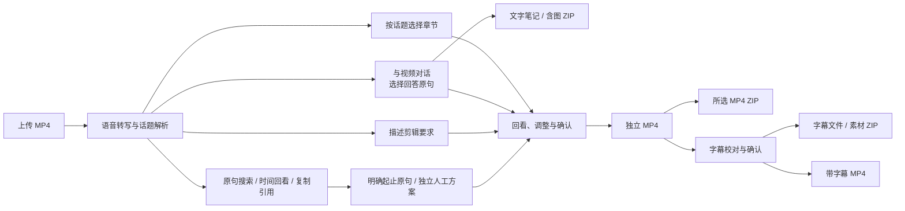

## 从哪里开始

| 你想做什么 | 使用入口 | 指南 |
| --- | --- | --- |
| 先看整段视频讲了哪些内容 | **话题切分**：选择、编辑、拆分或补充章节 | [按章节剪辑](#2-按章节浏览与剪辑) |
| 记得某个词，想直接回到那句话 | **原句搜索**：文字 / 时间搜索、分页、前后文和复制引用 | [搜索与回看原句](#原句搜索直接找词与时间) |
| 已选好起止原句，直接保留这一段 | **原句搜索 → 人工剪辑**：核对连续范围、保存和确认 | [按原句人工剪辑](#manual-asr-clips) |
| 先提问，再追到具体位置 | **视频对话**：回答引用回看、选择原句送去剪辑 | [问视频与按引用剪辑](#3-向视频提问并按回答原句剪辑) |
| 把有用的问答保存为资料 | 回答下的 **学习笔记**：复制文字或下载含图 ZIP | [保存问答笔记](#保存本轮学习笔记) |
| 已经知道自己想剪什么 | **按需剪辑**：输入要求，获取候选和排除依据 | [按需求找片段](#4-用自然语言找片段) |
| 修正成片字幕并交付 | 成片上的 **校对字幕** | [字幕与成片交付](#8-校对字幕并确认版本) |
| 换设备前保留未完成编辑 | **下载当前草稿 / 导入备份文件** | [历史与草稿恢复](#history-and-drafts) |
| 一次下载多个已完成视频 | 成片区的 **仅 MP4 ZIP** | [选择成片并下载](#7-查看和下载生成的-mp4) |
| 任务等待或失败 | **任务详情**与执行器状态 | [进度与恢复](#task-status-and-recovery) |

## 本地启动

默认使用 Windows PowerShell，在仓库根目录操作。准备 **JDK 21、Python 3.11、uv、Node.js 24.12+、Docker Desktop、FFmpeg / ffprobe**；FFmpeg 工具需加入 PATH，并支持 MP4 导出使用的 `libx264`。Java 使用仓库中的 Maven Wrapper，无需另装全局 Maven。已有原生 MySQL 的配置方式见下方文档，这里使用 Compose 准备数据库。

```powershell
git clone https://github.com/Lshiii/LiveCut-AI.git
cd LiveCut-AI
```

**首次准备：**

```powershell
uv sync --locked --extra ocr --dev --python 3.11
npm --prefix frontend ci

if (!(Test-Path .env.compose)) { Copy-Item infra/.env.example .env.compose }
if (!(Test-Path .env.java)) { Copy-Item .env.java.example .env.java }
```

在本地编辑 `.env.compose`，填写应用数据库密码 `LIVECUT_DB_PASSWORD` 和管理员密码 `LIVECUT_DB_ROOT_PASSWORD`。再编辑 `.env.java`，至少核对以下配置：

```dotenv
LIVECUT_DB_URL=jdbc:mysql://127.0.0.1:13306/livecut?useSSL=false&allowPublicKeyRetrieval=true&serverTimezone=UTC
LIVECUT_DB_USER=livecut
LIVECUT_DB_PASSWORD=替换为与.env.compose相同的应用密码
LIVECUT_STORAGE_ROOT=../storage
LIVECUT_WORKER_API_KEY=替换为自行设置的随机本地口令
LIVECUT_API_PORT=8080
```

> Compose 创建的业务库是 `livecut`；`.env.java.example` 原地址中的 `livecut_dev` 需要按上面改成 `livecut`。配置使用字面的 `NAME=value`，不要给整个值加 shell 引号，也不要把 `DASHSCOPE_API_KEY` 放进只接受 `LIVECUT_` 项的 `.env.java`。

启动 Docker Desktop，确认本机 `13306` 端口可用，再启动数据库：

```powershell
docker compose --env-file .env.compose -f infra/compose.yml up -d
docker compose --env-file .env.compose -f infra/compose.yml ps
```

等待数据库健康后，分别打开三个 PowerShell 终端，均从仓库根目录执行：

```powershell
# 终端 1：Java API；首次启动自动执行数据库迁移
.\scripts\java.ps1 -Task Run
```

```powershell
# 终端 2：输入 DashScope 凭证，用于 ASR 与默认文本模型
$env:DASHSCOPE_API_KEY = [Net.NetworkCredential]::new('', (Read-Host 'DashScope API key' -AsSecureString)).Password
.\scripts\worker.ps1
```

```powershell
# 终端 3：前端
npm --prefix frontend run dev
```

打开 **<http://127.0.0.1:5173/>**。API 健康检查为 <http://127.0.0.1:8080/actuator/health>。Worker 默认接收完整流程所需的阶段，保持该终端运行；不加 `-Once`，它只用于单次阶段执行。

如果使用其他 OpenAI-compatible 文本服务，在本地 `.env.java` 配置 `LIVECUT_TEXT_API_STYLE`、`LIVECUT_TEXT_BASE_URL`、`LIVECUT_TEXT_API_KEY`、`LIVECUT_TEXT_MODEL`；ASR 仍需自己的 DashScope 凭证。详见[文本服务与备用平台配置](docs/38-文本请求自动恢复.md)。

<details>
<summary>需要生成带字幕 MP4 时：安装固定字体</summary>

在启动 Java 前，从仓库根目录运行：

```powershell
uv run --frozen --no-sync python scripts/install-caption-font.py
```

将返回的字体**绝对路径**填入 `.env.java` 的 `LIVECUT_CAPTION_FONT_PATH`，然后启动 Java。字幕烧录额外要求 FFmpeg 支持 `ass / libass`。字体只用于带字幕视频；普通话题、对话与剪辑可先体验。

</details>

完整环境说明见 [本机集成与验收](docs/13-MVP集成与验收.md)、[Java 服务](docs/07-Java视频来源服务.md)和 [Python Worker](docs/09-Python计算Worker.md)。模型凭证只放在本地配置或环境变量中，前端不需要密钥。

## 图文使用指南

### 1. 上传视频，创建分析

**入口：左侧或右上角「上传视频」，然后进入「创建分析 / 任务详情」。**

1. 选择本地 MP4，等待文件校验、分片上传与合并。需要中断时点击「暂停上传」，之后使用原文件「继续上传」。
2. 选择「视频来源」。画面证据默认是「仅使用语音转写」；需要识别画面上的文字时，可选「本地 OCR · 识别画面文字」。
3. 核对「文本请求上限」，点击「创建分析任务」。默认上限为 24 次，自动重试与格式修复也会计入次数。
4. 等待任务显示解析完成，再进入「视频对话」「原句搜索」「话题切分」或「按需剪辑」。

**结果：** 同一视频已有可复用的转写和话题结果；后续提问、找片段与字幕校对沿用这些来源。


### 原句搜索：直接找词与时间

**入口：解析完成后，点击「原句搜索」。** 窄屏顶部工作区可左右滚动。

1. 留空可分页浏览原始转写；输入关键词或显示时间（如 `缓存 过期`、`02:30`），点击「搜索原句」。空格分隔的词需同时命中同一句，结果按原视频时间排列。
2. 点击结果查看前后各一句；选择不会自动播放。点击「定位所选原句」暂停并定位到起句，或用「连续预览前后文」回听；手动拖动或切页会停止该次预览。
3. 点击「复制所选原句引用」，复制原视频名、精确起止时间和原句。ASR 仍需人工核对，引用带有相应标记。
4. 翻页使用已提交的搜索词，输入框的新草稿会保留。读取失败时保留旧结果并标明范围，点击「重试读取」核对原请求。

这是对已有转写的字面搜索，适合记得原词或时间的定位；需要理解问题或找相关表达时，可进入「视频对话」或「按需剪辑」。搜索、前后文和回看均不新增模型或 ASR 请求，也不修改剪辑草稿。

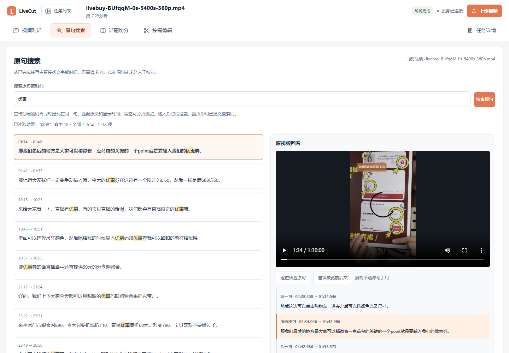

此图读取既有90分钟视频的756条原句，关键词“优惠”命中18句，播放器定位在01:34.046。没有替换业务响应、重新转写或请求模型；详细验收见[全文原句搜索与回看](docs/70-全文原句搜索与回看.md)。

<a id="manual-asr-clips"></a>

### 按原句人工剪辑：直接保留连续区间

**入口：「原句搜索」内的「搜索与回看 / 人工剪辑」两个视图。** 适合已经知道要保留哪些句子的情况，人工范围与原有 AI 剪辑方案、话题草稿分别保存。

1. 在「搜索与回看」用文字或时间找到起句，点击「设为人工起句」；可换搜索词、翻页，再选另一句并点击「设为人工止句」。起止必须属于同一视频及转写来源，倒置时需要明确调整。
2. 点击「查看人工片段」，进入「人工剪辑」，填写「成片标题」并点击「核对完整范围」。核对后显示真实句数、起止时间和预计时长；区间包含起句开头到止句结尾的全部音画、静音和中间未命中的句子。
3. 使用「定位人工片段起点」或「预览完整人工区间」回看，再点击「创建人工剪辑方案」保存为人工 r1。后续修改用「保存为新修订」，形成 r2 等独立版本。
4. 勾选「我已回看并接受句级边界及所选内容」，点击「确认人工 rN」。确认后还需明确点击「生成该版本 MP4」，才会排队编码。
5. 成功后可「预览人工成片」「下载人工 MP4」或「校对人工成片字幕」。仅需视频时，在「仅 MP4 ZIP」明确选择并「核对所选成片」，再「下载所选MP4 ZIP」；字幕与素材包继续使用各自的保存、确认流程。
6. 在「已保存人工方案」中打开历史，或点击某批成片的「查看此版本方案 rN」，重新读取该批冻结的原版本。最新 r2 尚未确认时，已确认 r1 的成片、字幕与 ZIP 仍按 r1 来源核对；有未保存修改或未决提交时不能覆盖当前草稿。

创建、保存或生成 MP4 后若网络中断，先点击「核对原提交」。系统按本机保留的原 key 和内容只读查询回执；只有确切确认原提交不存在时，才允许明确「按原内容重试」。不会因最新版本已变化而把新版本认领为原提交。普通未保存范围在同任务切页时保留，不承诺刷新后已备份；切任务、上传或离开页面也会保护脏稿与未决提交。

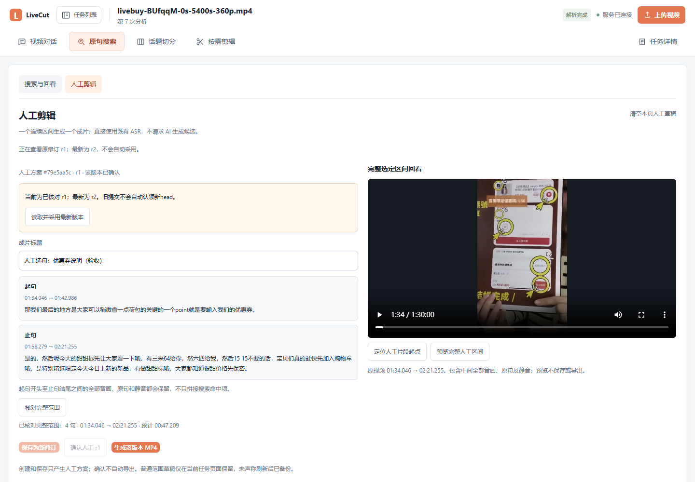

真实 API 与生产界面已在90分钟、756句的既有视频上核对：从 `01:34.046` 到 `02:21.255` 共4个连续原句，逻辑时长 `47.209s`，保留其中未命中搜索词的中间句。创建成功后模拟丢失回执，仅通过原回执 GET 找回 r1，没有重复 POST；另存未确认 r2 后，r1 仍完成真实编码。普通成片为 H.264/AAC、`3,935,356` 字节，ffprobe 读取时长 `47.233s`。

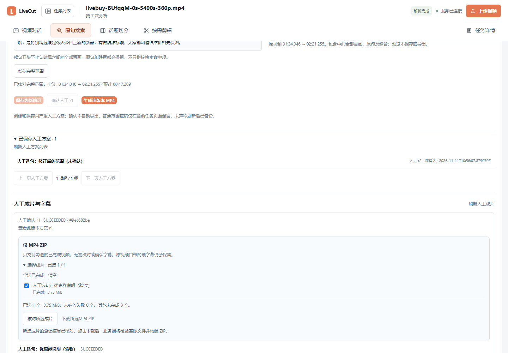

本轮已实际核对普通 MP4、字幕、素材包及带字幕成片。验收发现并修复了非帧边界剪辑的首PTS偏移和Windows长执行目录问题；保留旧成片与失败记录，另建人工方案重新导出，未覆盖已冻结文件。新普通片为 `3,936,477` 字节，带字幕片为 `3,875,792` 字节，均核对H.264/AAC、零时轴、时长和SHA256，并实际查看烧录字幕。流程复用了已有 ASR，没有新增模型或转写请求。人工剪辑体现人工兜底和交付可靠性，不作为 AI 创新或模型效果提升；完整来源、修订及恢复边界见[按原句人工剪辑](docs/71-按原句人工剪辑.md)。

### 2. 按章节浏览与剪辑

**入口：解析完成后，点击「话题切分」→「选择与编辑」。**

1. 点击话题标题或时间轴回看原视频，展开「原句转写」核对内容。
2. 勾选想保留的章节。点击「编辑」可修改标题、摘要、关键词与开始、结束时间；还可「拆分」或「＋ 在播放位置补片段」。
3. 点击「保存修订」，再点击「确认所选片段」。默认不会替你全选。
4. 切到「成片导出」，选择已确认版本与片段，点击「创建 / 打开导出」。

**结果：** 每个选中章节生成独立 MP4。后续修改会建立新修订，不会改写已经创建的成片。


### 3. 向视频提问，并按回答原句剪辑

**入口：「视频对话」。**

1. 输入问题，例如「视频里缓存为什么会失效？」「概括主要观点」，点击「开始提问 ↑」；已有对话中可继续「发送问题 ↑」。
2. 核对回答的「来自视频」「通用知识补充」或「视频证据不足」标记，点击引用中的「回看」定位原视频。
3. 在成功的「来自视频」回答中，勾选「选择此原句」，点击「按所选原句剪辑」。也可以将助手给出的文字建议「送到剪辑要求」。
4. 到「按需剪辑」核对预填内容，再明确点击「查找片段」，进入下一节的候选审核流程。

**结果：** 原句入口会绑定这次回答中选定的发生位置，组成**一个剪辑目标，可含多段**；不会用视频里另一处相似表达替代。两个送入剪辑区的按钮都只预填，不会自动调用模型或导出。

**找回旧对话：** 点击右上「对话记录」，按首个问题、创建时间和轮数辨认会话。用「上一页」「下一页」浏览，或「回到最新」；翻页会保留当前回答、未发送问题和请求上限。想打开另一条对话时，先发送或明确放弃已有输入，再点击对应记录。新选会话详情暂不可读时，保留原回答和草稿，可「重试读取所选会话」或「保留当前会话」。

历史列表按页读取摘要，当前会话的完整回答单独加载。旧服务兼容模式仍受最近100条限制；分页与恢复边界见[视频对话历史说明](docs/68-轻量分页视频对话历史.md)。

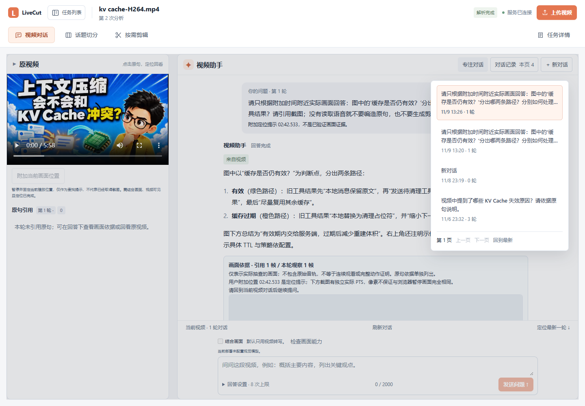

此图来自真实API的4条已有会话，未替换能力或历史响应；采图没有发送新问题或调用模型。更多页的操作使用明确合成的107会话另行验收，不把它们当成真实模型问答。

**结合画面（需单独配置视觉模型）：** 展开提问设置，明确选择“结合画面”，可以问「这张架构图为什么加缓存层？」「演示前后屏幕出现了什么变化？」Agent 可自主搜索字幕、查看指定时间的截图，或以每500ms一帧抽查最长12秒的短片。回答下方分别展示原句与画面依据；点击截图时间定位原视频，展开观察范围核对实际采样位置。画面引用不能直接当作字幕原句剪辑锚点。

想讨论当前屏幕时，在“结合画面”模式点击视频旁的 **“附加当前画面位置”**（窄屏显示“附加位置”），再输入「这张图为什么分两条清理路径？」。提问区会显示固定的位置提示，可移除或重新附加；之后拖动视频进度不会改变它。首次模型请求直接携带该位置的真实取帧，随后助手可继续查原句或补看画面。位置提示尚不是已观察证据，实际截图时间以回答中的来源为准。

如果切回文本模式，已附加的位置会保留，需明确移除或切回画面模式后再提交。网络中断后核对原请求仍使用原位置；你另外编辑的问题和新位置会分别保留。也可以不附加位置，在问题中写明时间和对象，例如「02:42 这张图为什么分两条清理路径？」。详见[位置与回执说明](docs/64-附加当前画面位置.md)。

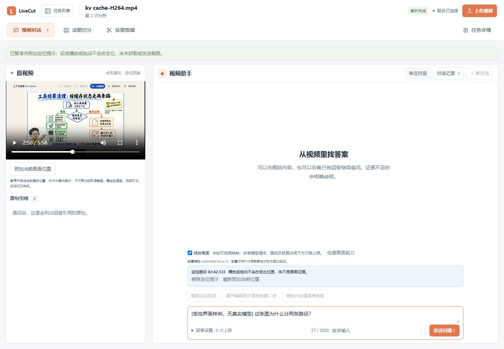

此图使用真实视频与受控能力接口演示未提交草稿：位置已固定，问题仍待发送，没有获取模型回答或调用真实视觉服务。

服务端未配置时保持文本模式。Java 的 `LIVECUT_AGENT_VISUAL_MODEL` 为新视觉轮次冻结模型；Worker 还需 `LIVECUT_AGENT_VISUAL_BASE_URL` 和 `LIVECUT_AGENT_VISUAL_API_KEY`，使用支持多图输入的 OpenAI-compatible 服务。全部决策、重试和修复都计入本轮模型请求上限；不会将图片转给原来的纯文本备用平台。配置示例见 [.env.java.example](.env.java.example)，完整边界见[按需画面观察](docs/63-Agent按需画面观察.md)。

> 这是按需抽帧观察，不等于连续看完整段视频，也不包含原始音轨。帧数量上限与请求次数上限不能换算为固定金额；后续决策再次携带截图可能再次产生图像 token。已用 DeepSeek Flash 完成给定位置的单张流程图真实小样；自主选帧、复杂代码和连续操作效果仍待分场景验证。

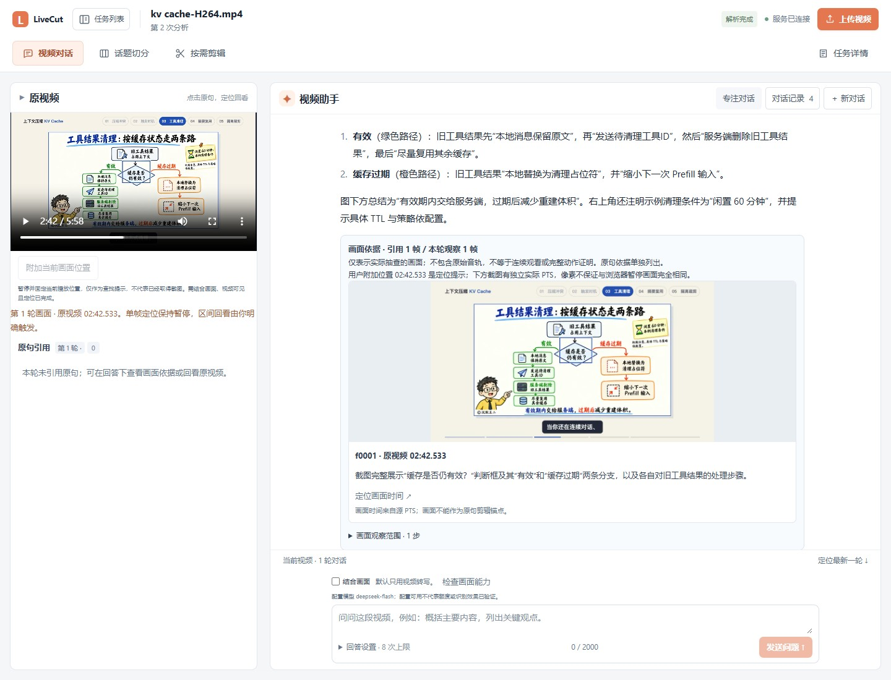

此图来自真实模型试验：附加02:42.533后，1次请求、1张截图得到回答，未新增ASR。首次取帧由用户附加位置触发；图中两条分支及示例TTL已人工核对，不能从这一个样例推算整体准确率。配置可使用 `deepseek-flash` + `https://api.deepseek.com`，密钥只放本地环境。


此图是**受控界面验收样例**：图片来自实际 FFmpeg 抽帧，问题、回答和工具轨迹由合成 HTTP 夹具提供，没有调用真实视觉模型。用于说明界面与回看方式，不代表模型理解效果。

<a id="structured-evidence"></a>

#### 分项证据回答：区分原话、画面与推断

在提问设置中选择「结合画面」，勾选 **「分项证据回答」**，再点击「检查画面能力」。该模式需要支持它的新执行器；页面会显示可用情况，未上线时明确等待，不把请求交给旧执行器。

可以问：「请分别说明讲者怎样解释缓存有效分支、图上实际显示了什么、哪些结论还只是推断。」需要讨论当前图时，先明确附加播放位置，再发送问题。


截图记录的是未发送的草稿与模式入口，没有新增模型调用；分项回答的实际效果以独立真实模型验收为准。

| 回答分项 | 如何阅读 |
| --- | --- |
| 原句依据 | 关联本轮实际查到的ASR，引用可回看或按原句继续剪辑 |
| 画面观察 | 关联实际输入模型的截图，不把图意自动归给讲者 |
| 前后采样 | 对照同一次短片采样的两张有序帧；查看两侧截图与时间 |
| 推断 | 单独标明推断及其依据，不能当作已观察到的因果 |
| 通用解释 | 视频证据之外的知识补充 |
| 证据不足 | 明确列出尚未查到或无法判断的内容 |

缺少所需原句或前后画面时，Agent可在原工具和请求预算内继续补查。正文和引用由这些分项统一生成；采样不能证明间隙中的动作或连续因果。开关只作用于新提问，旧回答和待核对原提交继续保留各自模式，保存学习笔记时也会保留分项标识。

新模式已通过受控工程回归，并完成一次真实DeepSeek Flash单图开发验收：1次请求、1张02:42.533截图，得到4项画面观察、1项推断和1项不足，实际笔记及含图ZIP可交付。该轮没有模型自主追加工具或检索原句，因此讲者解释只得到不足提示，不能据此声称自主补证已验证。

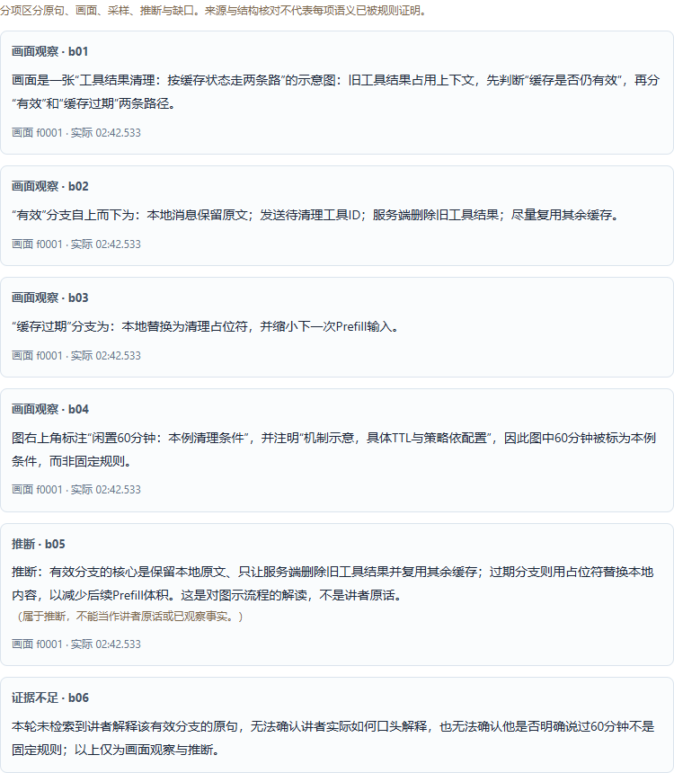

上述截图直接来自该真实结果。程序核对来源、模态、时序和引用，并不独立证明语义正确；完整自主补查、操作变化与质量对照仍待分场景评测。完整协议、实际请求用量和当前限制见[分项证据回答](docs/72-分项证据回答.md)。

#### 按回答中的截图继续提问

想继续讨论某张引用图时，点击截图卡上的 **“在此时间继续提问”**，再写具体问题，例如「有效缓存这条路径为什么还要通知服务端？」。程序会把该截图的实际时间附到下一轮，并切到“结合画面”，保留你已输入的问题和请求上限；最后由你点击发送。

如果草稿已附加其他位置，先选择“使用此时间”或“保留原提示”。截图入口不依赖播放器当前停在哪儿，也不需要先展开视频；采用时间时暂停预览，不跳转播放。发送后会重新取帧，旧截图不会直接作为新一轮的图片。能力未配置或尚未核对时，先配置模型并点击“检查画面能力”。详见[引用画面继续提问](docs/67-按引用画面时间继续提问.md)。

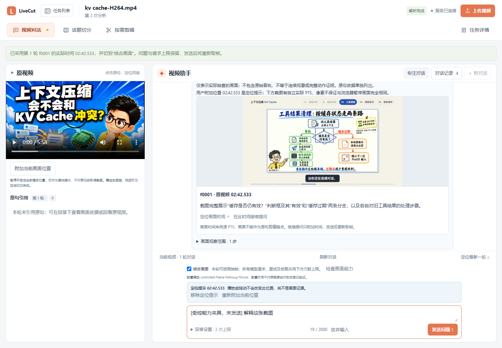

此图使用已有真实回答和截图，仅受控开启界面能力；草稿明确未发送，截图与采用时间均未新增模型请求。

#### 保存本轮学习笔记

在已完成的回答下点击「学习笔记」，核对视频文件名、回答类别和原句／截图数量。

- 「复制文字笔记」：保留本轮问题、原回答、原句全文与时间、截图说明和来源信息，适合粘贴到自己的笔记中。
- 「下载含图 ZIP」：包含 `note.md`、`source.json` 和被引用的实际 JPEG。解压后，在支持 Markdown 相对图片的工具中打开 `note.md`，即可离线阅读图文依据。没有截图的轮次只包含前两个文件。

笔记直接整理成功结果，不新增模型或 ASR 请求。通用知识、证据不足和用户位置提示会保留原标记；截图时间与原句时间分别记录。复制失败时预览仍保留，可以选择文字手动复制或下载 ZIP。详见[笔记内容与来源说明](docs/65-问答学习笔记.md)。

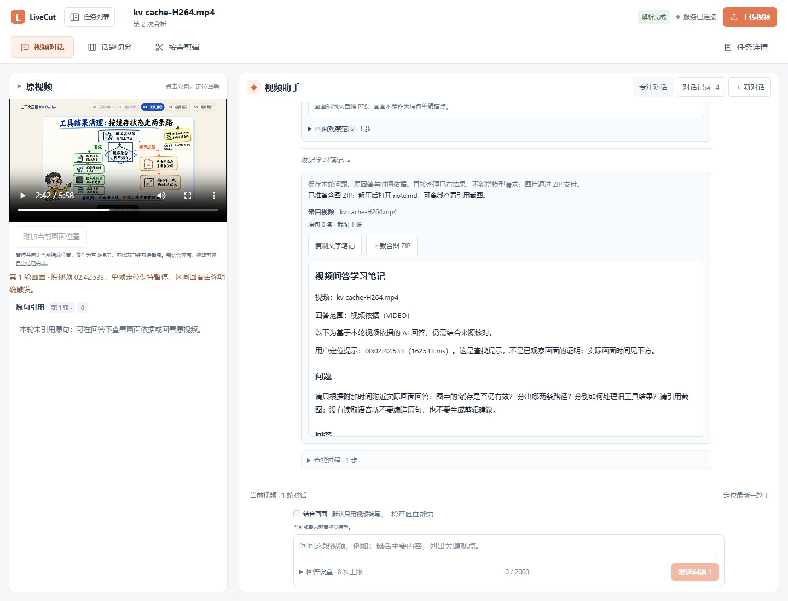

此图来自已有真实 DeepSeek 成功回答的实际笔记导出。该 ZIP 已下载、解包并离线核对截图，导出与截图过程没有新增模型请求。

**提问超时或网络中断：** 页面会保留原提交，在「待核对提交」中使用「核对原提交」。系统先查原记录，只有明确尚无记录时才按原标识与原问题重试；你另写的草稿和请求上限不会替换原提交。找回会话或轮次后不会自动再提问。新对话和新提问需先完成核对，避免把没有收到回执当作没有提交。

**切换页面后继续看回答：** 离开视频对话或隐藏页面时暂停自动读取，服务端任务继续执行；返回后立即核对最新结果，也可以点击「刷新对话」。刷新只读取已有状态，不会重新发送问题；未发送文字、请求上限和附加位置会保留。刷新频率和边界见[前台刷新说明](docs/66-视频对话前台刷新.md)。

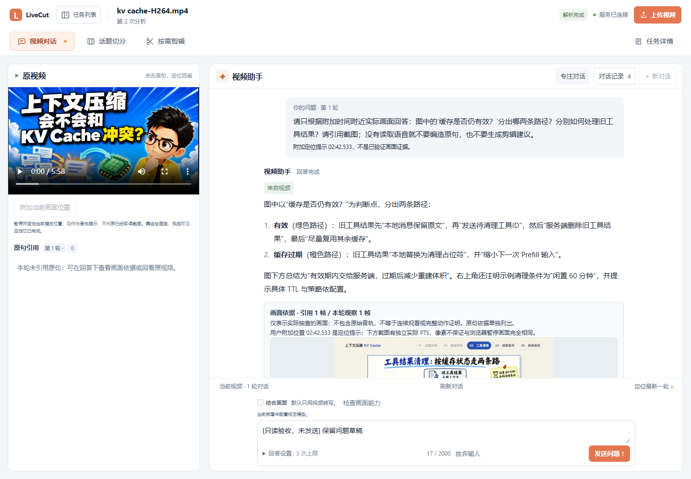

此图使用真实已完成会话，输入框明确是未发送的验收草稿；返回后只读核对，未新建问题或调用模型。

<details>
<summary>查看原提交核对与草稿保留</summary>


图中使用既有成功轮次模拟本机未决回执：原请求上限为 4 次，本页另写的草稿改为 7 次。核对只查询并找回原轮次，不发送这份新草稿，也没有新增模型调用。

</details>


送入剪辑区后，能看到原句文字、发生时间与回答来源。下图仍是**待提交要求**，点击「查找片段」后才开始生成候选。


> 原句候选先核对所选句及有限相邻上下文。你可以再手工扩展区间，但必须完整保留所选原句；这不代表系统已经读完所有上下文或证明了解释完整。

### 4. 用自然语言找片段

**入口：「按需剪辑」→「剪辑要求」。**

1. 描述目标和取舍，例如：**「把视频里缓存失效原因和解决方法分别剪出来，保留完整解释，跳过关注引导。」**
2. 核对「模型请求上限」，点击「查找片段」。普通文字要求可以包含多个目标；原句绑定请求保持一个目标。
3. 等待候选生成，进入「核对方案」。本次查找复用已完成的语音转写，不重新提交 ASR。

**结果：** 每个目标有独立候选、依据原句及保留区间；无法找到或无法安全确定的部分会明确标记。


### 5. 核对候选，保存并确认

**入口：「按需剪辑」→「核对方案」。**

1. 查看目标状态与理由，展开「依据原句」「排除内容」，结合原视频判断是否符合要求。
2. 使用「预览全部区间」连续回看，或「预览本段」检查某一段；可修改成片标题、增减保留区间。
3. 勾选需要交付的「已找到证据」目标，点击「保存方案」。
4. 若还要保留「需进一步核对」的候选，点击「批量人工核对与选用」：逐项回看、填写说明，明确接受当前整句边界，再提交。这会另存一个新版本；弹窗展示的是该版本的全部人工选用项。
5. 关闭核对窗口，再点击「确认所选目标」，随后「生成独立 MP4」。

**结果：** 方案和选用内容绑定到确认版本，每个所选目标输出一个文件；同一目标的多个保留区间按原视频顺序拼接。


| 候选状态 | 当前可以做什么 |
| --- | --- |
| 已找到证据 `FOUND` | 回看、编辑、勾选；保存并确认后导出 |
| 需进一步核对 `NEEDS_REVIEW` | 先回看并保存合法区间；有保留区间和依据原句时，可通过独立的「批量人工核对与选用」操作交付 |
| 未找到 `NOT_FOUND` | 查看原因，调整要求后另建请求；不能用无关片段填充 |

**人工选用需要重新核对的时机：** 修改标题、保留区间或普通勾选并保存后，旧人工选用不会继承。重新打开核对窗口，核对新版本的全部人工选用项；不再需要时使用「清空人工选用」。人工选用保留原 AI 状态，既不把候选改成 `FOUND`，也不代表系统证明了解释完整。

提交后网络中断时，使用「核对原操作」找回结果。系统保留原标识和输入，先查已有记录；不会因为没有收到回执就建立另一批人工选用。

<details>
<summary>查看「批量人工核对与选用」窗口</summary>


图中是开发验收样例：补回缓存过期后的清理分支，明确接受该句末尾的混合话术。它展示的是人的取舍，不代表系统已经去除句内引导或证明覆盖了全部解决方法。

</details>

### 6. 按文字选择准确的起止原句

**入口：候选「保留第 N 段」中的开始或结束「调整 ↗」。**

1. 在「选择区间原句」中切换「起句」「止句」，搜索文字或时间，例如 `02:30`。
2. 阅读候选及「查看前后原句」，选择从哪一句开始、到哪一句结束。
3. 点击「应用区间」或「应用并预览」，返回本页方案。

**结果：** 时间自动取起句开头至止句末尾。应用仅修改本页草稿，仍需保存和确认；不能覆盖同一目标中已排除的原句，也不能移除已绑定的回答原句。


### 7. 查看和下载生成的 MP4

**入口：话题的「成片导出」，或按需剪辑的「成片与字幕」。**

1. 查看导出批次和各片段的执行状态；等待成片成功。
2. 点击「预览」或「预览成片」检查真正生成的文件，再「下载 MP4」。
3. 需要批量下载时，展开「仅 MP4 ZIP」中的「选择成片」，手动勾选或「全选已完成」，再点击「核对所选成片」→「下载所选MP4 ZIP」。默认不勾选；每包最多 100 片，可只选同批已完成项，无需先确认字幕。
4. 需要字幕时，点击该成片上的「校对字幕」。话题导出还可下载「文件清单 JSON」留档。

**结果：** 获得基于确认版本生成的独立文件。浏览器中的原视频区间预览不等于已生成 MP4。

核对只重新读取所选成片的登记信息；显式点击下载后，服务端才校验实际文件并构建 ZIP。改选、隐藏或切换来源后需重新核对。包内只含所选 MP4、说明和来源清单，保留原视频自带的硬字幕。详见[批量 MP4 交付与验收](docs/69-批量下载已完成MP4.md)。

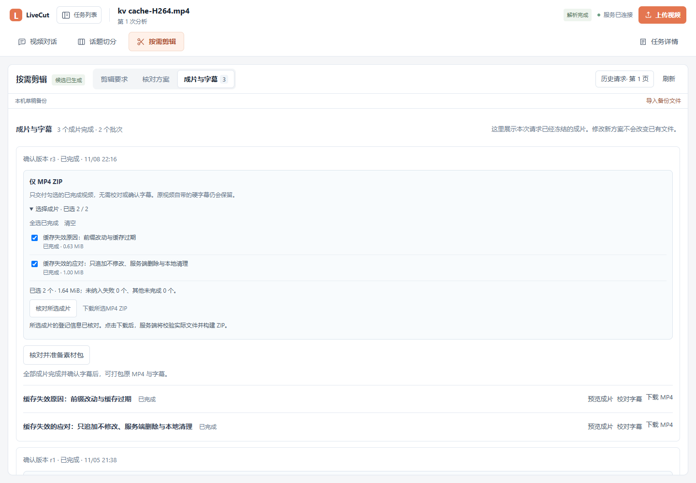

上图来自已有双片批次的真实只读验收：两片字幕尚未确认，仍可单独打包 MP4。截图没有重新生成成片或调用模型。


### 8. 校对字幕，并确认版本

**入口：已成功成片上的「校对字幕」。**

1. 回看成片，修正字幕文字和相对时间；可展开「原始转写参考」。字幕从**成片的 00:00** 开始计时。
2. 对「边界截断待核对」的字幕逐条回看，勾选「我已回看并核对这条截断句」；只改文字不会解除标记。
3. 点击「保存字幕」，再勾选「我已核对字幕文字与时间」。
4. 点击「确认字幕版本」，然后下载字幕，或进入「带字幕视频」。

**结果：** 字幕有独立的保存和确认版本。它由既有转写映射生成，不会再次识别语音，也不会覆盖原 MP4。


### 9. 批量修正重复错词

**入口：「校对字幕」中的查找框与「批量替换」。**

1. 查找错词，可勾选「忽略大小写」，并结合「只看待核对」筛选。
2. 展开「批量替换」，填写「替换为」，选择「全部字幕」或「当前筛选结果」。范围覆盖所有分页。
3. 点击「预览替换」，核对完整的替换前后文字，再「应用到本页字幕」。
4. 需要时「撤销最近替换」，确认后继续保存字幕。

**结果：** 只替换文字，时间、原始转写和逐句核对标记保持原样。保存、恢复草稿或关闭后，最近替换的撤销记录会清除。


### 10. 让 AI 提出字幕纠错建议

**入口：字幕面板的「AI 校对建议」；有未保存修改时先保存。**

1. 核对起始字幕、文本请求上限与可选的「校对要求与术语提示」，点击「开始本批校对」。
2. 查看本批实际覆盖范围，逐条核对「本轮输入」「建议改为」、理由及原句依据。
3. 勾选可采纳纠错项，点击「采纳所选到本页字幕」，再回到字幕列表保存和确认。
4. 长稿使用「选择下一批」继续，下一批仍需你明确发起。

**结果：** AI 只提出建议，不直接改服务端字幕。每批最多 20 条，且受文字长度限制；「建议回听」不能直接采纳，一批完成不等于整片校对完成。


### 11. 生成真正带字幕的 MP4

**入口：字幕面板的「带字幕视频」。**

1. 选择「已确认字幕版本」，设置「白字黑描边」或「深色底字幕」。
2. 选择输出画幅：保留原画幅、横屏 16:9、竖屏补边或竖屏背景柔化。
3. 点击「生成带字幕 MP4」，查看生成记录与编码进度。
4. 成功后预览并「下载带字幕 MP4」。

**结果：** 字幕实际写入一个新的 MP4。竖屏背景柔化保留完整清晰前景，用同源画面柔化填充背景；不是智能裁掉背景或删除原视频中已有字幕。


### 12. 下载字幕和素材包

**入口：字幕面板中「下载已确认版本与素材包」，或导出批次上的素材包操作。**

只需要视频时，可在成片区使用上一节的「仅 MP4 ZIP」。下列字幕素材包继续要求确认所交付的字幕版本。

1. 选择已确认的字幕版本，下载 SRT、VTT、TXT 或字幕 JSON。
2. 单片点击「原视频＋字幕 ZIP」；其中视频是已生成的原 MP4，字幕作为独立文件交付。
3. 整批交付时，先让本批所有成片成功并确认各自字幕，再点击「核对并准备素材包」→「下载本批素材包」。

**结果：** 取得版本明确的视频与字幕附件。未保存的本页改字不会进入下载包；烧录版 MP4 从上一节单独下载。


<details id="history-and-drafts">
<summary><strong>历史请求、本机草稿与恢复</strong></summary>

**入口：按需剪辑的「历史请求」，以及剪辑或字幕面板的本机草稿备份区。**

1. 历史请求每页 20 条，使用「较新一页」「更早一页」「回到最新」浏览。翻页不会切换当前编辑，也不会覆盖草稿。
2. 未完成内容可以「下载当前草稿」。在本机备份区「查看历史草稿」，再明确「恢复到编辑器」。
3. 从 JSON 文件恢复时，点击「导入备份文件」→「恢复导入草稿」。文件只在本页读取。

**结果：** 恢复的内容仍是草稿，需核对后保存。浏览器备份不等于服务端保存；来源或基础版本变化时，只能下载旧稿保留，不能强行覆盖新版。


</details>

<details id="task-status-and-recovery">
<summary><strong>任务进度、失败与恢复</strong></summary>

**入口：「任务详情」，或按需剪辑的「核对方案」。**

1. 任务等待执行时，先看执行器是否在线、是否支持对应能力；Java 接受了任务并不代表计算 Worker 已启动。
2. 普通分析有可用转写时，可「复用转写重新分析」；按需剪辑失败或取消后可「继续查找」，建立一次新的文本请求，保留旧记录。
3. 遇到「核对保存结果」或「核对原提交」，先使用对应核对入口，保留原要求和原请求标识。

**结果：** 有限自动重试和备用服务在原预算内处理临时故障；恢复不会清空已有转写，也不会无限增加模型调用。确认的旧成片继续可用。


向下查看请求预算和恢复操作。「复用转写重新分析」使用新文本预算；「新建一次分析」则会重新提交 ASR。


</details>

## 常见问题与能力边界

**视频两小时，处理也要两小时吗？** 不是按播放速度逐秒等待。实际耗时受抽音频、ASR 服务、文本请求、视频长度和本机编码资源影响，没有固定完成时间承诺；页面分别显示阶段与执行器状态。

**是不是直接把视频画面交给多模态模型？** 普通分析以 ASR 转写为依据，可选本地 OCR。视频助手明确选择“结合画面”后，视觉模型可以按需读取程序实际抽取的 JPEG 与时间标签，再补充证据、回答；不上传整场视频，也不代表逐帧理解。默认未配置视觉服务时不会发起视觉请求。

**为什么还需要人工确认？** ASR 可能有错字，模型也可能漏掉条件或上下文。「保留完整解释」是剪辑目标，程序能检查来源和区间，不能据此证明语义完整。

**能精确删除一句话里的关注引导吗？** 当前主要使用 ASR **句级**边界，不提供可信词级精切。正文与引导混在同一句时，候选可能保持「需进一步核对」。你可以调整为其他合法整句，或回看后明确接受当前整句并人工选用；这不会删除句内引导，也不会把 AI 判断改写为 `FOUND`。

**模型请求上限就是费用上限吗？** 是调用次数上限，不是金额。格式修复、自动重试和备用服务尝试都会占用次数；实际计费取决于所配置服务。

**提问失败后可以改几个字直接再发吗？** 请求结果未知时，请先「核对原提交」。当前草稿可以继续编辑，但新提问会暂时受保护；原问题、原请求上限和原标识分别保存，不能用改字或调预算的方式替换未知请求。详情见[提交结果核对](docs/62-视频对话提交结果核对.md)。

**AI 校对会自动确认字幕吗？** 不会。采纳只进入本页文字草稿，不修改原 ASR、时间或核对标记；保存、逐句核对、确认仍是独立操作。

**已经有字幕的视频能去字幕吗？** 当前不做去字幕。新字幕烧录到独立文件中，原画面里的字幕仍会保留。

**可以跨视频问答、联网找资料或直接自动发布吗？** 当前围绕单个视频，Agent 工具为只读；不提供跨视频知识库、联网搜索或自动发布流程。当前上传入口接收本地 MP4，不是全平台链接下载器。

## 技术实现

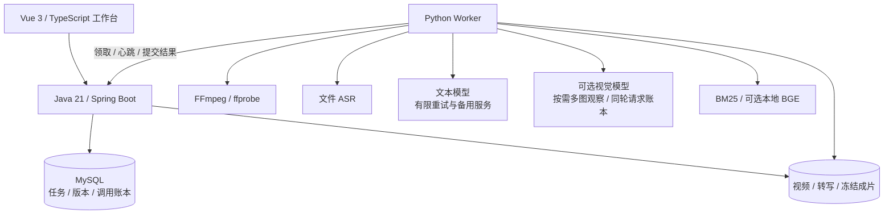

- **有依据的视频 Agent**：模型自主选择搜索转写、展开上下文、读取话题等白名单工具，在有界循环内回答；引用映射到原视频时间。采用严格 JSON 动作协议，视频依据与通用知识分别标记。
- **按需补充画面证据**：视觉模式增加关键帧和短片采样工具，由同一视觉模型观察后再决策；原始 PTS、实际图片、工具轨迹与回答引用绑定，Java 验证后提供同源截图回看。已完成给定位置的真实单图小样，完整质量评测仍待开展。
- **两种按需定位方式**：普通要求使用 BM25 与可选 BGE 向量融合检索；回答引用剪辑直接绑定选中的发生位置和邻句，避免重新检索到另一处同词内容。
- **Java 持久调度与资源控制**：感知 Worker 能力与容量，原子领取阶段，使用租约、attempt 与 run_token 拒绝迟到结果；模型预算和调用状态持久化。
- **可核对的原文搜索**：独立只读接口验证 ASR 与时间轴来源，以有界分页提供原句；文件读取放在短元数据事务之外，返回前再次核来源身份，其他任务进度不会误使同一转写失效。播放器、搜索和前后文各自隔离迟到操作。
- **独立人工方案与不可变回执**：从明确选定的 ASR 起止句创建 `MANUAL_ASR` 方案，不伪造 AI 候选或规划阶段。创建、修订和导出先持久保存原 key/body，再发送业务请求；未知结果先查原回执，读取其精确修订核对 hash。确认与导出冻结来源和版本，新 head 不替换旧提交或已确认成片；多窗口本机回执按请求独立保留。
- **版本与交付来源**：自动结果、人工修订、确认版本和导出各自保留；人工选用有独立批次，与方案、原句来源及确认版本绑定；按有序区间冻结 MP4，字幕按成片时间轴映射。
- **编辑与恢复**：本机备份、保存回执核对、按任务和版本隔离迟到响应；剪辑历史仅分页读取摘要，选中后再加载完整转写与方案。
- **视频对话历史**：Java用只读一致性快照和微秒keyset游标读取摘要、批量统计轮数；全任务活动数与所选全文独立。翻页不覆盖当前稿，详情失败不隐式新建对话，旧提交按完整来源另行核对。

这些是当前实现机制，不代表独立识别准确率、吞吐量提升或付费需求已经得到验证。真实样例与合成测试的范围记录在各功能文档中。

### 目录

```text
backend-java/   Java 业务 API、MySQL 持久化、调度与版本管理
worker-python/  ASR、检索、Agent、FFmpeg 与计算 Worker
frontend/       Vue / TypeScript 工作台
contracts/      Java、Python、前端共同数据契约
scripts/        本机启动、依赖检查与验证脚本
fixtures/       可提交的小型合成测试样例
docs/           设计、操作细节与验收记录
```

### 继续阅读

| 主题 | 文档 |
| --- | --- |
| 话题解析与章节剪辑 | [当前需求与技术路线](docs/32-通用视频话题解析.md) |
| 视频对话与引用剪辑 | [视频 Agent](docs/45-视频对话Agent.md) · [回答原句联动剪辑](docs/58-回答原句联动剪辑.md) |
| 直接搜索和回听转写 | [只读分页、原句前后文和播放定位](docs/70-全文原句搜索与回看.md) |
| 从起止原句直接剪辑 | [独立人工方案、原提交恢复与版本交付](docs/71-按原句人工剪辑.md) |
| 按需看图与视觉证据 | [多图工具、采样边界与部署配置](docs/63-Agent按需画面观察.md) |
| 讨论播放器当前画面 | [附加位置、首次取帧与原位置恢复](docs/64-附加当前画面位置.md) |
| 继续讨论回答中的截图 | [按引用画面时间准备下一轮问题](docs/67-按引用画面时间继续提问.md) |
| 查找旧对话 | [轻量分页、完整详情与未决提交恢复](docs/68-轻量分页视频对话历史.md) |
| 按需剪辑与恢复 | [需求检索](docs/37-按需求检索与剪辑方案.md) · [人工核对与选用](docs/61-待核对候选人工选用.md) · [有限自动恢复](docs/38-文本请求自动恢复.md) · [保存结果核对](docs/53-剪辑方案保存结果核对.md) |
| 字幕和成片交付 | [仅 MP4 批量下载](docs/69-批量下载已完成MP4.md) · [字幕与素材包](docs/47-字幕校对与素材包.md) · [带字幕 MP4](docs/49-带字幕成片导出.md) · [竖屏柔化](docs/50-竖屏柔化背景.md) |
| 校对与本机编辑 | [批量术语校对](docs/55-字幕搜索与批量术语校对.md) · [AI 纠错建议](docs/56-AI字幕纠错建议.md) · [本机草稿](docs/54-本机草稿备份与恢复.md) |
| 调度、上传与历史 | [执行器感知](docs/36-执行器感知与资源调度.md) · [分片上传](docs/19-持久分片上传.md) · [轻量历史分页](docs/60-轻量分页剪辑历史.md) |
| 数据契约与完整索引 | [共同契约](contracts/README.md) · [文档总览](docs/README.md) |

历史直播商品版本、CLI 实验和逐轮验收保留在文档索引中；当前工作台主线是通用长视频理解与切分。功能交互参考过 [DOVideo-AI](https://github.com/Xiaoc7r/DOVideo-AI)，具体能力与限制以本仓库实现和文档为准。
