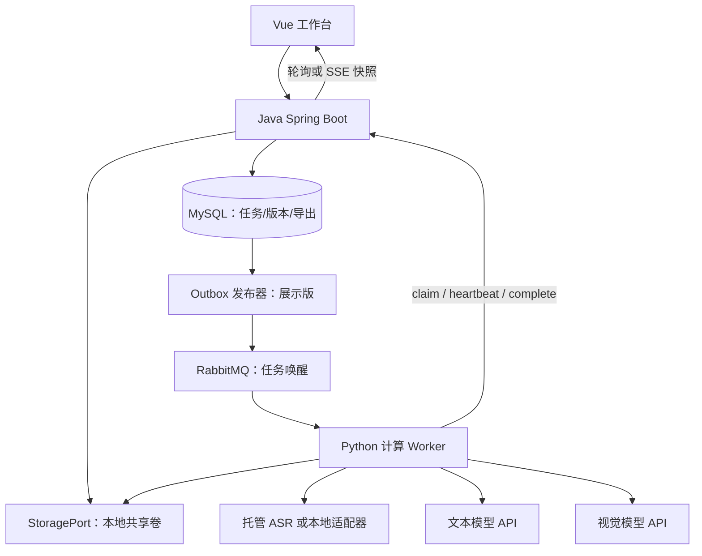

# LiveCut AI 技术路线与接口约定

v1.0｜2026-10-23｜设计稿。模型、性能和成本需要真实样本验证。

## 1. 总体架构

先采用模块化业务服务和计算 Worker。Java 是任务状态的唯一写入方，Python 通过内部接口领取任务、报告心跳和提交结果，不直接修改业务数据库。



MVP 不安装 RabbitMQ；Python 按空闲槽位调用 Java 获取 READY 阶段。展示版加入 MQ 后仍使用相同领取协议，数据库扫描保留为低频兜底。消息只是“有任务可领取”的通知。

### 推荐选型

| 层 | 选型 | 取舍 |
|---|---|---|
| 前端 | Vue 3、TypeScript、Element Plus、原生 video | 时间轴先用普通组件；不先集成复杂剪辑 SDK |
| 业务后端 | Java 21、Spring Boot、Spring JDBC、Flyway | 用显式 SQL 实现状态迁移；熟悉 MyBatis 可替换，二者选其一 |
| 数据库 | MySQL 8.x，开发启动时锁定具体可用版本 | 用事务、唯一键和行锁保证状态推进 |
| 计算 | Python 3.11 起步、FFmpeg/ffprobe、Pydantic、httpx | 先验证依赖兼容再锁版本；Worker 不必为了展示而额外运行 FastAPI |
| ASR | 托管文件 ASR 优先；FunASR 本地适配器可选 | 无 GPU 时先避免本地大模型部署阻塞闭环 |
| 文本与视觉 | 可配置文本模型 + Qwen 系列 VL API 适配器 | 每次运行记录准确 model_id；不绑定滚动的“最新模型”别名 |
| 文件 | 本地共享卷 + StoragePort | 后续按部署需要替换 S3/OSS；不把 MinIO 当首版依赖 |
| 消息 | RabbitMQ + Outbox，M2 加入 | 阶段状态仍由 MySQL 决定 |
| 部署 | 本机开发，随后 Docker Compose | GPU 运行环境不作为基础依赖 |

Java 21 位于当前 Spring Boot 官方兼容范围内；创建代码时确认准确 Boot 与依赖组合，提交构建锁定信息，不能只写浮动 latest。[Spring Boot 系统要求](https://docs.spring.io/spring-boot/system-requirements.html)

## 2. 先打通模型输入，避免环境陷阱

### 2.1 默认无 GPU 路线

1. 本地 FFmpeg 提取音频。
2. POC 用百炼录音文件识别 REST API；模型 ID 以账户所在地域实际可用项为准，可先验证文档中的 paraformer-v2。
3. POC 可使用官方推理临时存储上传音频，再将临时资源提交给支持该方式的 REST 接口；正式稳定部署改用私有 OSS 对象和服务可访问的 HTTPS 签名地址。
4. 保存供应商 task_id 后轮询既有任务，下载原始转写，统一成项目 ASR 格式。
5. 文本 API 接收句子与商品清单；视觉 API 接收本地抽取后编码的少量图像及实际时间标签，不上传整场录像给 VL。

注意，文件 ASR 的 Python SDK 文档要求 HTTP/HTTPS 文件 URL；本地路径、Docker 内部路径不能直接提交。官方区分 SDK 与 REST 的临时 oss:// 资源支持，REST 的临时资源还需要指定解析请求头。POC 必须按对应接口的文档实现，不能混用。[录音文件 SDK](https://help.aliyun.com/zh/model-studio/paraformer-recorded-speech-recognition-python-sdk)、[REST 接口](https://help.aliyun.com/zh/model-studio/paraformer-recorded-speech-recognition-restful-api)、[临时文件上传](https://help.aliyun.com/zh/model-studio/get-temporary-file-url/)

临时上传方式只用于短期个人验证；官方明确它有有效期且不建议用于生产。记录过期时间，恢复任务时重新生成可用输入资源。下载到本地的转写和检查点不依赖临时 URL 长期存在。

API 开通、地域、费用与可用模型必须先做 1～3 分钟样本验证；本方案没有核验用户账号权限，也没有实际支出。

### 2.2 本地替代路线

如果不使用托管 ASR，固定 FunASR 的具体 checkpoint、Python/PyTorch 版本与时间戳配置。先在 1 分钟音频上验证文本和句级时间戳，再测试长视频耗时。不要把“FunASR 支持时间戳”推导为任意模型/服务后端都返回相同字段。[FunASR 官方 API 说明](https://github.com/modelscope/FunASR/blob/main/docs/python_api.md)

CPU 能否满足个人演示速度由实测决定。首版不训练模型，不自建 VLM 推理集群。

## 3. 处理阶段

```text
MEDIA
  → ASR[0..N-1]
  → SEGMENT
  → VERIFY（配置关闭时显式 SKIPPED）
  → TIMELINE
  → REVIEW_READY

人工编辑/确认 → 独立 EXPORT 任务 → EXPORT_CLIP[0..M-1]
```

这是固定依赖流程。`job_stage` 允许某类阶段有多个 shard，不开发通用 DAG DSL。M0/M1 可先每段视频一次 ASR；M2 为长视频拆成约 5～10 分钟块，准确块长由服务限制及实测决定。仅在完成全部必要块后进行全局文本合并，不能静默跳过失败块。

### 3.1 MEDIA：统一时间与文件

- ffprobe 获取时长、音视频流、start_time、帧率、旋转信息。首版只支持经过验证的 MP4 输入；不支持的流明确报错。
- 定义原视频用户可播放开头为 t=0，所有区间使用全局整数毫秒，采用半开区间 `[start_ms, end_ms)`。
- 非零 PTS、音视频起始偏移需要保存明确的 media_time_offset；不能分别抽音频/代理视频后假定它们起点相同。POC 用起/中/末三个可辨认事件核验对齐。
- 可生成低清预览代理；原视频、代理、音频各自记录来源和时间映射。只有确认共用时间轴才可共用 start_ms。
- 块内 ASR 时间 = 局部时间，合并时加 chunk_start_ms。少量重叠上下文用句子时间与文本对齐去重，不按“文字相同”全局删除，因为主播会重复说同句话。
- 超出范围或缺失时间戳不交给 LLM 猜；阶段失败或显式降级为不可定位结果。

### 3.2 ASR：输出时间锚点

项目统一格式：`utterance_id, start_ms, end_ms, text, source_chunk_id`。ID 在同一 transcript_version 中稳定唯一。保留供应商原始响应和字段转换逻辑，不在拼接字符串时丢弃时间戳。

云文件 ASR 支持句/词级时间字段，但它们是模型估计，仍需对齐验证。[官方结果字段](https://help.aliyun.com/zh/model-studio/paraformer-recorded-speech-recognition-python-sdk)

异步 ASR 的提交与等待应区分：供应商 task_id 一旦拿到就保存为检查点。Worker 恢复时先继续查询该 task_id，不直接重新提交。提交已发生而响应丢失时仍可能重复收费，见成本章节。

### 3.3 SEGMENT：目录约束的语义分段

初始参数：核心窗口 180 秒，前后各增加 30 秒上下文。每句按时间中点归属一个核心窗口，上下文仅帮助理解，不产生第二份正式归属。

最快实现按窗口顺序处理，将上一窗口的已知商品状态和少量未决证据传给下一窗口。后续如果并行窗口，需要单独实现跨窗口指代与冲突处理，不能假设其天然独立。

文本模型输入：窗口内带 ID 的 ASR、核心窗口范围、目录快照、上一窗口状态。输出：

```json
{
  "segments": [{
    "start_utterance_id": "u_0035",
    "end_utterance_id": "u_0057",
    "content_kind": "product_talk",
    "identity_status": "ambiguous",
    "candidate_sku_ids": ["bag_001", "bag_002"],
    "evidence_utterance_ids": ["u_0035", "u_0041"],
    "reason_codes": ["SPEC_UNCLEAR"]
  }]
}
```

模型不能自由生成正式时间数字。程序验证 ID 存在、顺序正确、属于许可输入，由对应句子映射 start/end_ms。提示词要求将转写中的“忽略规则”等文本当视频内容，不作为系统指令。

同 SKU、相邻且语义连续的段可以合并；跨窗口重叠且相同的候选去重，存在身份冲突则标记审核。不同时间的返场不可用大区间并集连接，否则会把中间其他商品剪进去。

### 3.4 VERIFY：先观察，再加密

1. 对每个候选区间取首、中、尾少量不同帧，首尾避开精确切点；以实际采样 PTS 标记时间。相同帧跨候选复用。
2. 要求 VLM 只返回可见属性、候选 SKU/未知、可见性；模糊或不可见不能算矛盾，也不能凭空补品牌/规格。
3. 目录无法唯一匹配、跨窗口判断矛盾、基础观察音画冲突、语义切换不明确时，围绕疑似边界加密，例如前后各 10 秒、约 3 秒间隔。
4. 每个边界最多一轮额外请求；仍不确定则待审核。视觉校验关闭或预算耗尽时，显式记录 not_checked 或 BUDGET_EXHAUSTED。
5. 讲解边界仍以语义任务为准。视觉不一致首先产生审核理由，而非自动把语音 A 改成视觉 B。

最初给每任务总帧预算、每边界局部预算、图像分辨率上限和请求 token 上限。具体数值在开发集选择；例如 30 分钟试验先设总 120 帧作为资源护栏，帧预算不足时按风险优先分配，不能声称每段都已视觉覆盖。

Qwen 官方支持多图/视频输入与采样信息，但时间定位、SKU 判断和细粒度切点仍需要本场景实测。不同模型服务对音频和视频的能力不同；此方案明确将 ASR 文本与采样图像合并，而不假定 VL 自动听到了音轨。[Qwen3-VL 官方仓库](https://github.com/QwenLM/Qwen3-VL)、[百炼图像与视频说明](https://docs.bailian.console.aliyun.com/en/model-studio/vision)

PySceneDetect、独立 OCR、图像向量检索均延后。固定机位下的商品切换可能没有镜头变化；画面变化只能作候选信号。

### 3.5 TIMELINE：身份与审核

本场目录是身份命名空间。明确相同 SKU 的区间直接聚合；不同规格不自动合并。名字相似只用于召回候选，促销价格不作为稳定身份主键。

身份分为 matched、unlisted、ambiguous、not_applicable。未知商品每段保留未决归属，首版不跨段自动归并“未知实体”。UI 可由人工为多个区间选择同一目录 SKU；清单外商品可新建本场人工商品条目，保存人工身份来源与审核补充目录，不能据此宣称模型精确识别了外部 SKU。

`risk_score` 是规则审核排序分，不是真实正确概率。建议优先展示 review_reasons；所有模型结果初始仍为 DRAFT，低风险也不能绕过用户确认直接正式导出。

## 4. 存储与数据表

大文件和详细 ASR/模型输出保存为 JSON/媒体文件，MySQL 存索引、状态和不可变路径。不必第一天为每条 ASR 语句建行。

| 表 | 关键字段与约束 |
|---|---|
| video_asset | id、content_hash、source_key、duration_ms、media_metadata；源文件不可变 |
| analysis_job | id、video_id、catalog_hash、config_hash、generation、status、state_version、budget；幂等键唯一 |
| job_stage | id、job_id（来源分析任务）、owner_type、owner_id、stage_type、shard_key、status、attempt、run_token、worker_id、claim_request_id、lease_until、hard_deadline_at、next_run_at、input_hash、checkpoint_key、manifest_key、error；UNIQUE(owner_type,owner_id,stage_type,shard_key) |
| timeline_revision | job_id、revision、snapshot_key、snapshot_hash、review_catalog_key、review_status、created_at；UNIQUE(job_id,revision) |
| export_job | id、job_id、approved_revision、selection_hash、encoding_profile_version、status；导出指纹唯一 |
| export_clip | export_job_id、segment_id、stage_id、固定起止时间、output_key；执行状态由关联 job_stage 提供，不另存一份权威租约 |
| outbox_event，M2 | event_id、aggregate_id、payload、published_at、attempt、next_send_at |
| model_call，M1 最小实现 | request_id、stage_id、attempt、provider_task_id、model_id、input_hash、status、reserved_amount、settled_amount、usage、estimated_cost、actual_cost；请求和预算预留必须持久化 |

job_stage 是统一可执行任务表：分析阶段使用 owner_type=ANALYSIS、owner_id=analysis_job.id；每个导出片段也创建 stage_type=EXPORT_CLIP、owner_type=EXPORT、owner_id=export_job.id 的任务。两者共用领取、租约、心跳和结果隔离，完成时分别聚合所属父任务。job_id 仅保留来源分析上下文，不能把导出失败传播成分析失败。

M1 即需 Java 持久化 checkpoint_key 和 model_call 的 provider_task_id，按 stage_id + input_hash 恢复；新 attempt 输入不变时先接续供应商既有任务，不因旧执行凭证失效丢掉外部任务。资源过期或供应商明确失败后重新提交要新建调用记录、占用预算并遵守限次。

阶段领取需要 `(status,next_run_at)` 索引，过期扫描需要 `(status,lease_until)` 索引。父任务串行推进使用行锁；跨步骤按固定锁顺序实现，避免死锁。文件参考路径限定在当前任务目录。

重跑分析创建新 job 与 generation，已有时间轴和审核记录保留。generation 取同一视频的分析序号；stage 的 attempt 只表示同一输入下的某次实际执行，不与审核 revision 混用。

完整初始自动结果使用 [Schema](../contracts/analysis-result.schema.json)。Schema 校验类型；以下跨字段条件由业务校验器检查：时间有序且不超总时长、引用 ID 存在且唯一、SKU 属于目录、机器预测边界对应有效语句、单主播片段无非法交叠。人工审核快照使用独立编辑模型，允许任意合法毫秒边界，记录 origin、boundary_source、identity_source 与原始预测 ID；手工新增片段不要求伪造 ASR 锚点。

## 5. 可恢复执行协议

### 5.1 状态

阶段：`BLOCKED → READY → RUNNING → SUCCEEDED / SKIPPED`；可重试失败进入 `RETRY_WAIT → READY`；超过次数进入 `FAILED`。取消后进入 CANCELLED，禁止创建新阶段。

分析任务：`QUEUED → RUNNING → REVIEW_READY`，异常为 FAILED/CANCELLED。导出是独立任务，不因导出失败把分析改为 FAILED。

只有 Java 调度器决定重试。建议自动重试最多 2 次，即最多 3 次实际执行；参数错误/媒体损坏直接失败，429/短暂网络错误退避。SDK 的隐式重试必须计入策略，不允许多层无限重试。

### 5.2 执行前领取，防止重复付费

Python 先有空闲执行槽，再请求 Java 原子 claim。Java 在事务内锁定父任务并以条件更新领取 READY 阶段：

```sql
UPDATE job_stage
SET status = 'RUNNING', attempt = attempt + 1,
    run_token = :token, worker_id = :workerId,
    claim_request_id = :claimRequestId,
    lease_until = :leaseUntil, hard_deadline_at = :deadline
WHERE id = :stageId AND status = 'READY'
  AND next_run_at <= CURRENT_TIMESTAMP;
```

租约时间由数据库时钟计算。提交成功才返回 stage_id、attempt、run_token、输入引用和预算。领取前只校验完成幂等是不够的：两个 Worker 仍可能同时调用收费模型。

claim_request_id 支持领取响应丢失后查询/重试同一次请求，只在该领取仍有效时返回同一凭证；不允许同一请求偷偷领取第二个阶段。

### 5.3 MQ 的 ACK 语义

展示版：收到通知 → 获得执行槽 → Java claim 提交成功 → ACK → 开始计算。ACK 代表任务已交接给持久化数据库调度，不代表推理完成。claim 被拒绝且任务已被其他 Worker 领取时 ACK；Java 不可用时有限退避，不能 ACK 后悄悄丢掉唯一任务凭证。

ACK 后 Worker 崩溃由租约回收；READY 周期扫描负责再次唤醒。因此不能删除数据库兜底扫描。短暂唤醒丢失不会丢业务任务。

Outbox 与创建 READY 阶段同事务写入。发布器发送持久消息到持久队列，处理 publisher confirm 及 mandatory return 后标记已发送；确认响应丢失可以再次发送。消息不携带可变业务输入，Worker 总是读 Java 返回的当前输入。

这提供重复投递下的状态幂等，不承诺外部推理恰好一次。ACK 与 publisher confirm 是两个不同边界。[RabbitMQ 确认机制](https://www.rabbitmq.com/docs/confirms)

### 5.4 心跳与旧结果隔离

初始设置可用每 15 秒心跳、90 秒租约；每类任务另设硬截止时间。心跳线程活着不代表模型请求有进展，hard_deadline 到达后停止续租。调用 HTTP 和 FFmpeg 子进程均设超时。

所有心跳、进度、成功、失败提交都验证：`stage_id + attempt + run_token + status=RUNNING`。心跳更新 lease，不改变本次凭证，不让领取时的 version 被自己的心跳废掉。

租约到期表示允许回收；扫描器使用条件更新清除旧 token 并转入重试。完成和回收竞争时，以数据库先提交的状态迁移为准：回收先成功则旧回调失效；完成先成功则扫描无法回收。取消也撤销 token。

旧 Worker 写自己的 attempt 目录，不能覆盖公共 result.json。Worker 用临时文件 + 同文件系统原子改名完成产物，最后生成含哈希的 manifest：

```text
jobs/{job_id}/stages/{stage_id}/attempts/{attempt}/{run_token}/manifest.json
```

Java 只接纳当前凭证下通过校验的 manifest。过期文件以后清理，不能当新结果。

### 5.5 完成与依赖推进

Java 完成事务：按 owner_type 锁定分析或导出父任务 → 验证当前凭证 → 写成功结果引用 → 检查全部必要子任务 → 激活下一阶段或更新导出批次 → state_version++ → 写 Outbox → 提交。

并行最后两个子任务完成时必须串行检查父级依赖，且下一阶段有唯一约束，否则会发生“两边都没看见对方完成，永远不推进”。

回调结果：ACCEPTED/ALREADY_APPLIED 表示完成；STALE_ATTEMPT 表示丢弃。HTTP 响应丢失时重试同一完成请求或查询状态，不能重新调用模型。相同已成功 attempt 和结果哈希返回 ALREADY_APPLIED；不同哈希不能覆盖。

## 6. 审核版本、播放与导出

时间轴采用不可变快照。编辑请求带 expected_revision，冲突返回 409；成功产生新 revision。人工新增商品保存到该审核版本的补充目录快照，原目录不变。确认具体 revision 后才能导出。重新分析不覆盖旧审核内容。

导出创建时冻结源文件哈希、已确认 revision、片段 ID 与起止毫秒、编码参数。幂等指纹可使用这些规范化输入的 SHA-256；用户反复点击返回同一任务。

正式成片默认转码 H.264 + AAC，并使用准确 seek，附加 faststart。不要把 `-c copy` 当任意时间点精确裁剪；官方说明 stream copy 会保留部分寻址前内容，而转码默认可解码后丢弃。[FFmpeg 文档](https://www.ffmpeg.org/ffmpeg.html)

示意命令，由程序计算 start_seconds 与 duration_seconds；未经过实际媒体验证前不承诺帧级切点：

```text
ffmpeg -ss <start_seconds> -i <source.mp4> -t <duration_seconds>
       -map 0:v:0 -map 0:a:0? -c:v libx264 -preset veryfast
       -crf 23 -c:a aac -movflags +faststart <attempt_output.mp4>
```

所有参数用 subprocess 参数数组传递。导出后检查返回码、文件大小、ffprobe 时长，并人工抽查起止画面与音画同步。媒体服务支持 Range 请求，使浏览器跳到后半段无需下载整个文件。

## 7. API 草案

| 方法与路径 | 作用 / 核心约束 |
|---|---|
| POST /api/videos | 流式写入视频，校验后登记，不把整文件读进 JVM 内存 |
| POST /api/jobs | video_id + catalog + config，支持 Idempotency-Key |
| GET /api/jobs/{id} | 当前状态快照、state_version、子任务计数、错误 |
| POST /api/jobs/{id}/cancel | 取消并撤销未完成领取 |
| POST /api/jobs/{id}/retry | 仅恢复失败阶段；输入变化使用新 job |
| GET /api/jobs/{id}/timeline | 指定 revision 或最新快照 |
| POST /api/jobs/{id}/timeline/revisions | expected_revision + edits，写新快照 |
| POST /api/jobs/{id}/timeline/approve | 确认指定 revision |
| POST /api/exports | approved_revision + segment_ids + profile；冻结输入 |
| GET /api/exports/{id} | 批次和逐片段状态 |
| GET /api/media/{assetId} | 视频预览/下载，支持 Range |
| GET /api/jobs/{id}/events，M2 | SSE 当前快照 |
| POST /internal/stages/claim | worker_id + capacity_type + claim_request_id，可指定 stage_id |
| POST /internal/stages/{id}/heartbeat | attempt + run_token，更新租约 |
| POST /internal/stages/{id}/checkpoint | 当前凭证 + provider_task_id/检查点引用 |
| POST /internal/stages/{id}/complete | 当前凭证 + manifest_key + hash |
| POST /internal/stages/{id}/fail | 当前凭证 + 错误类别，不由 Worker 决定全局重试 |
| POST /internal/model-calls/reserve | 当前阶段凭证 + request_id + input_hash + 用量上界，事务预留成功后才允许发起模型请求 |
| POST /internal/model-calls/{requestId}/update | 保存 provider_task_id、调用状态与用量/费用，重复相同更新幂等；UNKNOWN_OUTCOME 不释放预留；过期 attempt 可补记自身调用账务，不能改当前阶段结果 |

内部接口使用单独环境配置的认证凭证，仅在内部网络开放。JSON 失败响应统一包含 error_code、message、retryable、request_id；原始供应商错误留后端日志。

### SSE 的恢复边界

MVP 用 2～3 秒轮询。M2 建连/重连立即从 DB 读取完整快照；后端定期检查 state_version，仅版本变化时发送完整快照，前端忽略旧版本。保留终态快照和轮询兜底。

这是状态恢复，不是逐条历史事件重放。`Last-Event-ID` 本身不会替服务端保存历史；若未来要重放，再添加持久事件表与每任务顺序号。[SSE 标准](https://html.spec.whatwg.org/multipage/server-sent-events.html)

## 8. 成本、缓存与观测

阶段输入指纹包含视频内容哈希、目录哈希、模型 ID、Prompt/流水线/预处理版本与采样配置。输入未变才可复用；改 Prompt 后不误用旧结果。模型原始响应缓存不可替代运行记录。

每小时源视频成本 = ASR 费用 + 文本输入/输出费用 + 图像/视觉 token 费用 + 存储/流量 + 实际租用计算资源。供应商用量和单价按运行日期记录；若缺实际计费项则标估算，不伪装精确总价。

资源上限建议先配置为：活跃分析任务 1，文本/VL 各并发 1～2，转码并发 1。可设置试验总预算如 200 元、单任务上限如 10 元作为个人配置示例；这不是报价，不保证能完成全部测试，需先用 10 分钟样本估算。

在发请求前，Java 通过事务持久化 model_call 并原子预留该请求的费用上界或 token/帧额度，避免并发请求同时通过预算检查。明确结束且费用已核定后结算，仅释放未使用部分；UNKNOWN_OUTCOME 继续占用保守预留，直到供应商结果或人工核账，不因客户端超时立即释放。拿不到供应商准确费用时使用保守估算，可能需要人工核账。

请求已被供应商执行而响应丢失时，若无供应商幂等能力，不能保证不重复收费。记录 UNKNOWN_OUTCOME；优先查既有 task_id，昂贵请求不盲目重试。账单应包含失败请求、重试、基础采样和加密调用，不能只算成功结果。

日志统一 job_id、stage_id、attempt、request_id；汇总阶段耗时、模型调用数、输入图像量、token、重试、失败原因、人工修改比例。先用结构化日志和报告脚本，不先部署一整套监控平台。
