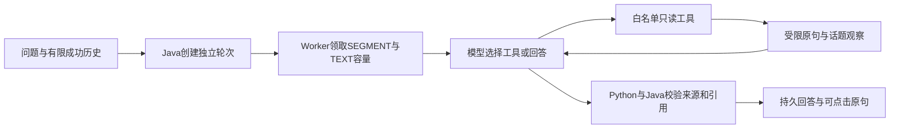

# 视频对话 Agent

2026-11-06：用户要求能与 AI 对话，围绕视频获得更多信息。在已完成的 topics 分析上新增独立视频助手，支持多轮追问、搜索原句、展开前后文、读取话题及带证据回答。

## 用户流程

打开已完成分析的视频，在“视频助手”输入问题，例如“视频里缓存为什么失效”“刚才提到的两种原因有什么区别”“概括这段视频”。助手自主选择只读工具，读取观察结果后再决定继续查找或回答。界面保留会话与历史，显示请求和恢复状态；引用可定位原视频并播放对应原句。

回答区分 VIDEO、GENERAL、INSUFFICIENT：分别为本轮视频证据回答、通用知识补充、当前证据不足。自动话题标题和摘要也需结合原句复核，不能当作独立人工事实。用户希望剪辑时，助手可给出剪辑要求；点击“送到剪辑要求”只安全预填原面板，已有未保存草稿或正在提交时拒绝覆盖，用户仍需提交、审核、确认和导出。

2026-11-07 增加独立的“按所选原句剪辑”入口：只对成功 VIDEO 回答选择具体引用，冻结回答身份与原句位置，生成单目标多区间候选。它不再只传一段文字，也不能重新检索后用另一处相似句代替所选位置。普通文字建议入口保持原语义；来源、预算和恢复规则见 [回答原句联动剪辑](./58-回答原句联动剪辑.md)。

## 执行链路

这是模型驱动的有界工具循环：工具名和参数由模型选择，程序执行后返回结果，允许多次查找后结束。使用严格 JSON 动作协议，复用已有 OpenAI-compatible/DashScope 文本适配；没有引入 LangGraph，也不描述为供应商原生 function-calling API 或多 Agent。

| 工具 | 参数与行为 |
| --- | --- |
| search_transcript | query 1～300 字，top_k 1～8；当前转写 BM25，配置本地 BGE 后使用向量与 BM25 的 RRF 融合 |
| read_context | 原句 ID、before/after 各 0～3；展开该句及前后原句 |
| list_topics | offset 0～20000、limit 1～12；分页读取原自动话题及起止原句，不读取人工草稿 |

每轮最多 4 个工具步骤，之后只能回答。重复相同工具参数不重复检索，返回受控提示。每次逻辑模型决策最多一次结构修复，修复和故障重试共用本轮预算。工具结果保留完整原句，每次观察约 12000 字符、累计约 36000 字符；丢弃的原句不能成为引用。

长视频可能超过 48 个话题，4 步分页不保证读取完整目录，上下文也可能截断。提示明确要求只概括已查看部分，不能声称完整看过视频。首版不是任意长度全文无遗漏总结器。

## 状态、预算与恢复

V14 增量迁移新增 agent_session、agent_turn。会话冻结视频哈希、原 ASR/TIMELINE 路径和摘要、原话题与原句。每次新提问重新核验来源；人工审核修改不改变会话来源。公开响应不包含这些私有路径或执行凭证。

每轮为独立 AGENT_TURN owner，复用 SEGMENT、TEXT 容量、Worker 注册/领取/心跳、租约及 attempt/run_token 隔离。成功或失败只推进本轮，不改变父分析、人工修订和导出，也不占父分析预算或提交 ASR。

默认每轮 8 次文本调用，范围 1～24。Java 先预留再授权外发，保留 UNKNOWN 原调用；沿用 90 秒/次、最多 3 次、每逻辑请求总窗口 240 秒，以及阶段内健康记录和冻结路线。8 次是整轮上限，3 次重试不能绕过它。

同会话只允许一个活动轮次，由服务端行锁保证；幂等键命中先返回已有回执，再判断忙状态。每会话最多 100 轮，每轮冻结最近至多 6 对成功问答、总字符最多 12000。失败或取消回答不进入成功历史，旧回答也不能充作本轮引用。首版独立轮询，不宣称逐 token 流式输出或完整 SSE 事件重放。

可取消等待或执行。次数、工具步数、阶段截止或恢复窗口耗尽时停止，准备产物、原分析和旧历史保留；新提问建立独立预算，不清空旧账本。成功调用经账本/哈希重放，Agent 本地响应另记摘要；缓存或来源不匹配明确失败。

## 引用与接口

共同结构为 [agent-answer.schema.json](../contracts/agent-answer.schema.json)。模型只选择引用 ID，程序映射原句、整数毫秒和原文。VIDEO 至少引用一句，ID 必须来自本轮工具实际返回的原句，不能只因存在于整片转写就引用；引用去重并按源顺序排列。

Python 发布前校验动作、工具、步数和引用。Java 再校验 session/turn/job/video、source/transcript hash、原问题、主模型、工具返回 ID 及引用原文/时间。agent_answer 使用专用 manifest 验证，保留普通分析必须 analysis_result、剪辑必须 clip_plan 的旧约束。

工具轨迹仅显示工具名、参数和证据数量，不展示思考过程、供应商地址或凭证。工具只有当前来源的只读能力，不提供任意文件、联网、SQL 或 shell。实际执行 search 后才记录 bm25/bm25_dense_rrf；仅上下文/话题/知识回答为 none。备用的实际模型通过 trace 与调用账本核对。

| API | 行为 |
| --- | --- |
| POST /api/jobs/{jobId}/agent-sessions | body {} 与 Idempotency-Key，冻结完成的 topics 来源 |
| GET /api/jobs/{jobId}/agent-sessions | 来源会话列表 |
| GET /api/agent-sessions/{id} | 会话与按序轮次 |
| POST /api/agent-sessions/{id}/turns | question、可选 max_text_calls，幂等创建异步轮次 |
| GET /api/agent-turns/{id} | 状态、预算、进度和最终回答 |
| POST /api/agent-turns/{id}/cancel | 取消并拒绝迟到结果 |

## 验证边界

合成模型测试覆盖工具循环、知识补充、证据不足、多轮历史、未观察或伪造引用、工具/参数/步骤/修复/预算限制、缓存篡改、取消、来源哈希和 Worker 分流。真实 MySQL 集成覆盖并发、幂等、独立预算、UNKNOWN、取消与父分析不变。

测试通过只证明这些工程约束，不证明所有语义事实正确或检索准确率提高。真实供应商、页面和最终 CI 需在实际验收后单独记录；素材、原响应、数据库与配置留在忽略目录。

## 真实问答与本机验收

来源为现有 KV Cache 话题任务 `abf80c2f-f3b0-419c-bd73-569edd1b0367`，复用 43 条原转写和 7 个原话题。会话 `d9a80be0-b0af-4533-87dc-07090dfa14de` 的第一轮经公开 API 创建，第二轮由真实页面发送；两轮均完成，没有新 ASR。

| 轮次 | 实际问题与工具 | 调用账本 | 结果 |
| --- | --- | --- | --- |
| 1 | KV Cache 失效原因；search_transcript | TEXT 2/4，2 SUCCEEDED | VIDEO 回答、6 条原句引用，实际 bm25_dense_rrf |
| 2 | “刚才第 2 点和第 3 点有什么区别”，要求前后文；search_transcript → read_context | TEXT 4/4，3 SUCCEEDED、1 UNKNOWN_OUTCOME | 正确承接历史中的滑动删消息与本地改工具输出，VIDEO 回答、5 条原句引用 |

第二轮实际遇到一次连接超时，trace 为 PROVIDER_TIMEOUT → RETRY_WAIT → 下一次成功，没有刻意注入故障，也没有切换到备用平台。旧调用保持 UNKNOWN_OUTCOME；本地超时不能证明供应商是否收到或计费。业务库 JDBC 只读核对共 6 条记录，均为 deepseek-flash/TEXT，其中 5 成功、1 未知，ASR 0；5 个完整 HTTP 200 响应文件与成功记录对应，不能把未知尝试也算作成功响应。

两份结果与 API 返回逐项相同，manifest 内产物 SHA256 重新核验通过。网页刷新后两轮成功历史仍在；点击第二轮首条引用定位到源视频 18.369 秒，播放器已就绪且无媒体错误。页面控制台未观察到错误。原来源分析、话题审核、用户已有剪辑请求，以及旧 KV Cache 分析/剪辑/导出共 7 个公共资源与部署前基线逐项相同，未替用户改选或确认片段。

本机全量：Java 243 项、0 失败/错误/跳过；前端 122 项、类型检查和生产构建通过；Python 1374 项及 101 项 subtests 通过，1 项 POSIX 专用测试在 Windows 跳过，Ruff 通过。最终 Linux 无跳过及公开检查状态以 [PR #5](https://github.com/Lshiii/LiveCut-AI/pull/5) 对应提交为准。

新 Java/Worker 已在本地启动，数据库保留原数据并正常增量应用 V14。核对记录为忽略目录 `data/runs/video-agent/real-artifact-verification.json`、`real-session-result.json`、`source-before.json`；截图为 `agent-live.jpg`。原素材、原响应、账本及配置不提交公开 Git。本次是开发样例问答与恢复验收，没有独立人工准确率或延迟/成本改善结论。
