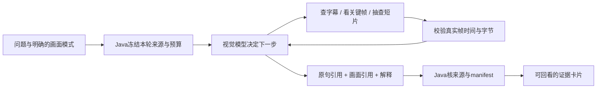

# Agent 按需画面观察

2026-11-09：用户选择让 Agent 自主查字幕、看相关画面，再带原句与截图时间回答。本文约定首版的多图工具循环、来源与预算边界；真实视觉问答效果和付费意愿尚未验收。

## 用户流程

视频助手保留普通文本模式。服务端配置视觉模型后，用户可明确选择“结合画面”，本轮冻结视觉模式、模型和请求上限。Agent 可先查原句，再查看架构图或短片中的屏幕变化；也可以直接观察用户明确提到的时间。回答分别展示原句与画面引用，点击截图时间回看原视频。画面引用不能直接作为原句剪辑锚点。

需要指向播放器当前画面时，可使用后续的[附加位置入口](./64-附加当前画面位置.md)：明确冻结用户选择的位置，采用独立1.2协议与执行能力；未附加的位置仍沿用本文1.1链路。

视觉模型直接执行本轮规划与回答，不另外隐藏调用一个收费观察模型。每次 OpenAI-compatible chat/completions 都计入同一轮 max_text_calls（历史字段名，视觉模式界面称“模型请求上限”），包含物理重试和结构修复。默认关闭视觉，不改旧会话或普通提问。视觉模式不使用纯文本备用平台。

模型只选择工具、引用与解释；时间、图片和哈希由程序生成并验证。涉及画面关系或变化的问题，应先看相应画面；没有取得图像时不能用字幕推测冒充已观察事实。

## 冻结的跨端协议

- 新阶段 `AGENT_VISUAL`，owner 仍 `AGENT_TURN`，阶段全程保守占用 `TEXT` 与 `FFMPEG` 两个资源槽；旧 Worker 不支持该阶段，不能领取。独立 V20 迁移给 agent_turn 增加 visual_mode，默认 `none`，取值 `none|frames`。
- POST turns 允许可选 `visual_mode: "frames"`；省略或 `none` 保持旧指纹，旧未知提交必须原 key/body 核对。frames 模式使用服务端 `LIVECUT_AGENT_VISUAL_MODEL`，留空则明确拒绝新视觉请求；不接受用户传任意模型或地址。配置冻结在 turn.text_model_id，fallbacks=[]。
- Turn 快照增加 `visual_mode`；旧快照缺字段按 none 解析，AGENT_VISUAL 必须 frames。预算字段保持原样。
- GET `/api/agent-capabilities` 只读返回 `{visual_mode: null|"frames", visual_model_id: null|string, max_frames:32, max_clip_duration_ms:12000, clip_sample_interval_ms:500}`。仅代表部署配置，不表示供应商账号额度或效果已验证。
- Worker 使用独立 `LIVECUT_AGENT_VISUAL_BASE_URL` / `LIVECUT_AGENT_VISUAL_API_KEY`（可明确复用 DASHSCOPE_API_KEY），只能走已计账的 OpenAI-compatible chat/completions；不走旧未计账原生 vision POC。

服务端模型配置与执行器在线能力分别检查。普通 Worker 未配置独立视觉服务时不应默认领取视觉任务；显式启动视觉执行器须在注册前完成配置预检。能力检查不额外请求供应商，不表示凭证权限或额度已经验证。

## 工具和观察边界

文本工具保持原行为；视觉模式新增：

| 工具 | 精确参数 | 行为 |
| --- | --- | --- |
| inspect_frames | `{timestamps_ms: integer[1..4]}` | 严格递增、唯一、在原视频范围内的时间；返回真实取帧时间与 JPEG |
| inspect_clip | `{start_ms:integer,end_ms:integer}` | 半开区间，0 < end-start <= 12000；每 500ms 取一帧，最多 24 帧 |

每轮仍最多4个工具步骤，累计最多32个不同请求时间的帧。重复位置复用已取帧；完全重复调用不再执行。所有实际帧均须在媒体范围，位于请求时间之后且相差不超过1000ms；短片帧还须在请求区间内。使用真实源 PTS，拒绝未经验证的非零起点时间轴，不以请求 seek 时间冒充实际帧时间。帧最长边1280，不放大，每帧 JPEG <=1MiB，全部帧 <=16MiB。达到上限返回明确的工具观察错误，不编造内容。后续决策可能再次携带已观察图片，因此32是不同帧数量上限，并非总图像 token 或金额上限。

单次工具按批次完成：非空帧列表必须精确对应本次全部请求时间，不能漏掉某个采样点而仍伪装成完整成功；失败返回空帧列表和工具观察错误，仍可依据此前已看过的证据回答。完全重复的工具调用同样只返回空帧提示，不再次执行。实际毫秒由整数 PTS 与 time_base 精确换算，不使用 FFmpeg 日志中经过格式化的 pts_time 小数作为权威值。

来源或缓存完整性损坏，以及图片发布/索引持久化失败会直接终止本轮，不再花模型预算继续尝试；已有转写、旧轮次和旧成片保留。可恢复的取帧或上限错误才作为空工具观察交回模型。

精确 `PTS × num × 1000 / den` 和 HALF_UP 后的展示毫秒都要通过全视频范围及请求容差检查；不得因舍入把请求前一小部分时间的帧认成请求后的帧。短片的半开区间边界以精确 PTS 为准，例如实际1499.9ms仍在 `[1000,1500)` 内，展示舍入成1500ms不改变其归属。展示毫秒不是短片边界的判断依据。

`inspect_clip` 是短片的 **2fps 画面采样**，不包含原始音轨，不等于连续观看或完整动作证明；字幕另由原句工具读取。模型可解释已见变化，不能断言采样间隙发生/未发生某事。模糊或缺帧时明确证据不足。图中指令均为不可信内容。原视频哈希、帧哈希与范围必须核验后才能入模；结果中不存在任意文件读取或远程 URL 工具。

## 回答 1.1 与持久证据

旧 `agent-answer.schema.json` 1.0 完全保留。新增 `agent-answer-visual.schema.json` 1.1，仅用于 AGENT_VISUAL，prompt_version=`video-agent-visual-v1`。

保留1.0顶层字段，并增加：

- `visual_evidence`: 本轮已实际送到模型的所有帧，按首次观察的 frame_id 排序。每帧精确字段 `{frame_id,requested_ms,timestamp_ms,source_pts,source_time_base,sha256,bytes,width,height}`。frame_id 固定连续 `f0001`..`f0032`，requested_ms 全轮唯一。source_pts 为非负安全整数，source_time_base 为正整数 `num/den`，timestamp_ms 使用 PTS 换算并 HALF_UP 到整数毫秒。无文件路径或供应商 URL。
- `visual_citations`: 回答引用的子集，精确字段 `{frame_id,explanation}`，最多12条，唯一且按 frame_id 排序；explanation 1..1000字。只能引用实际观察的 visual_evidence。
- tool_calls 各步统一增加 `result_frame_ids`。文本工具该列表为空；视觉工具 result_utterance_ids 为空。帧须由此前本轮真实工具产生并实际送入决策，不能仅靠模型列一个 frame_id。工具失败可两个列表都空。
- VIDEO 至少有一个原句或一个有效画面引用；GENERAL/INSUFFICIENT 保留原区分。模型输出决策增加 `visual_citations`（只含frame_id/explanation），不允许模型生成时间或哈希。

帧持久化到当前 fenced attempt 的 `visual-frames/{frame_id}.jpg`，manifest kind=`agent_visual_frame`。Java 验证所有已声明帧一一对应 manifest、实际 JPEG 字节/hash/尺寸及时间，拒绝多余、重复、越界或跨轮证据。result 由程序从实际取帧记录组装；模型仅选引用和解释。尚未成功观察的失败帧不成为证据。

GET `/api/agent-turns/{turnId}/visual-evidence/{frameId}/content` 只读：仅成功的 frames 轮次、已验证结果与原 manifest 中的帧，重新核对来源与文件哈希，返回 image/jpeg；拒绝任意路径、过期结果和跨轮引用，不即时重新抽帧。不暴露共享存储路径。图片加载失败保留文字回答并给出失败提示。

Worker 抽帧前核原视频完整字节哈希。每张截图 GET 重验已冻结的来源身份/准备产物 manifest、结果摘要和实际 JPEG 字节，不重复扫描数 GB 原视频；它不是对原视频当前全字节的重新认证。

## 验收

先用严格标注的合成响应验证完整工具循环和真实 FFmpeg 输出，不能称作真实视觉理解成功。覆盖假引用、错时间/hash/来源、能力不匹配、预算耗尽、未知调用恢复、纯文本降级禁用、旧1.0/旧提交兼容与320px截图卡。真实模型调用需显式预算，不复用先前已耗尽额度的假设；未跑真实视觉样例前不声明识别效果提升。

后续真实模型小样应包含下列问题，并与同一素材的字幕模式分别记录；这些目前是验收设计，不是已完成的质量评测。

| 场景 | 检查什么 |
| --- | --- |
| 图中箭头、层次或分支关系 | 实际看图后回答，截图位置与解释是否支持结论；字幕没说的内容不能伪装成原句 |
| 操作前后界面变化 | 自主定位相关讲解并补看短片；能否指出已见变化，同时保留采样间隙的未知 |
| 模糊代码、遮挡或未展示的结果 | 是否承认证据不足，而非根据常识补出屏幕内容 |
| 讲述与画面不一致 | 分开表述语音和画面，不自动把任一方当作唯一事实 |

人工核对答案正确性、原句/截图引用是否匹配、漏掉哪些必要画面，以及从问题到可核对回答的实际耗时；模型调用次数、输入图像/token与重试从真实账本/usage记录，不从预算上限推算实际金额。给定时间直接看图与完全自主找位置需要分开报告。

### 2026-11-09 工程验收

| 范围 | 实际结果 |
| --- | --- |
| Java 全量 verify | 395/395，无失败、错误或跳过；含V20、双资源、旧回执、真实JPEG读取与篡改、精确PTS边界和混合回答原句剪辑 |
| 前端 | 417/417，类型检查和生产构建通过 |
| Python 全量 | 1750 passed、101 subtests；1项Windows不适用的POSIX信号测试跳过，Ruff通过 |
| PowerShell 启动器 | 20次mock启动、8种阶段参数转发、非法参数拒绝通过；未启动真实Worker |
| 受控浏览器 | 桌面、320px、图片失败、纯画面、视觉丢回执找回、能力关闭后原样重试，共6项通过；真实写入/模型调用均为0 |
| 真实视频离线检查 | 实际FFmpeg取出3张帧并原样编码进入fake planner请求，哈希/时间/最终引用匹配；转写和决策为明确的合成夹具，不是供应商效果验收 |
| 独立预览 | V20迁移后仅agent_turn新增列和Flyway迁移记录变化；其余25张表、265条模型账本的完整内容摘要不变，旧1.0问答可读，未配置时视觉模式关闭 |

本机首轮曾有旧导出恢复测试超过其25秒夹具租期；未放宽生产guard或测试期限，独立导出模块26/26及随后完整全量均通过。公开Linux CI仍以对应提交的实际运行结果为准。

以上证明工程链路与约束，不证明视觉模型解释准确、剪辑语义完整、成本改善或用户愿意付费。本轮未调用真实视觉供应商。

接口依据：[Qwen 多图输入官方文档](https://help.aliyun.com/zh/model-studio/vision)。首版使用多图输入与独立时间标签，不依赖原生视频或音视频接口。

后续已完成给定位置、单张流程图的独立真实 DeepSeek Flash 小样；同轮先发生的百炼额度拒绝与剩余预算均保留。见[附加位置的真实小样与边界](64-附加当前画面位置.md#2026-11-09-独立真实小样)，不将其当作自主选帧或完整质量评测。
