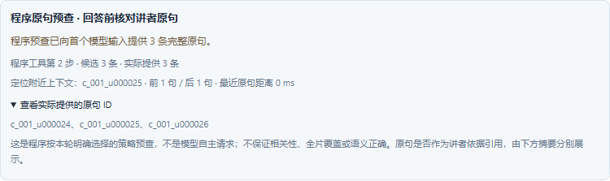

# 回答前原句预查与执行协议版本

## 目标

真实开发样例中，模型接收截图后直接回答“未检索到讲者解释”，但实际没有请求原句工具。仅调整提示词无法保证读取；事后摘要能揭示缺口，却没有补充证据。

新增默认关闭的「回答前核对讲者原句」策略：程序先执行一次有界本地原句查询，把实际取得的完整原句与截图一起交给模型，再由模型回答或继续使用剩余工具。只对用户明确选中的新问题生效，不靠关键词猜测，不修改既有轮次。

本策略保证一次预查及实际入模记录，不保证原句相关性、全片检索覆盖、答案完整或语义正确。有返回仍允许合理不足，不能为了通过规则强迫模型引用无关原句。程序预查不称作模型自主选择工具。

## 输入与版本隔离

- 新请求可选 `evidence_policy:"speech_lookup_v1"`，仅允许 `visual_mode:"frames"` 与 `evidence_mode:"structured"`；省略保持原 1.3 或更旧行为，显式 null / 未知值拒绝。原未决提交按原 body/key 核对，不因当前选择变化补字段、改预算或重发未知调用。
- 新 owner 冻结该策略，指纹在既有完整指纹后追加 `\nevidence_policy=speech_lookup_v1`。同 key 不同策略冲突。没有策略的旧指纹逐字节保留。
- 阶段仍为 `AGENT_EVIDENCE`，新任务冻结 `required_worker_protocol=2`，原阶段默认 1；结果用 1.4、prompt `video-agent-evidence-speech-v1`。不新增阶段枚举，不复写旧 1.3 SYSTEM / prompt / 配置 hash / 缓存。
- V24 新增通用执行协议字段，V25 新增 owner 策略字段。注册支持的版本为显式集合 `[1,2]`，不按大小推断兼容；省略为旧 `[1]`，null / 重复 / 空 / 布尔 / 未知版本拒绝，同一 session 集合不可变。
- 声明可领取 `AGENT_EVIDENCE` 的 Worker 会话先核对独立能力接口 `/api/agent-capabilities/speech-lookup` 的精确 `{speech_lookup_supported:true,worker_protocol:2}`。仅真实 HTTP404 使用纯旧注册 body 和 ready 查询；503 / 非法响应不降级。其他阶段会话固定 v1，不依赖此接口，保留原注册 body 与 ready 查询。同进程切换阶段需分别保存探测缓存与当前会话版本，不能把 v2 声明带入无关阶段或改变存活 session。承诺 v2 后不能失败改成 v1 继续同一任务。
- ready 携带成对 worker/session，以已登记版本、阶段类型和目标任务在 SQL LIMIT 前过滤；旧无 session 查询只列 v1。claim 首次领取及原回执重放都在事务内复核协议，即使关闭旧注册强制要求，也不能匿名领取 v2。拒绝领取不能遗留 attempt、token、claim 回执或模型账本。
- v2 ready / claim 显式回传 `required_worker_protocol:2`，v1 省略。执行器状态查询可显式筛 v2，保持原响应形状；资源占用按全部执行器计算，不能遗漏旧任务占用。

上述隔离由新服务端执行。默认执行器视图按协议 1 计算容量，明确选择协议 2 时才计算对应容量；仅声明 `[2]` 的执行器不能被计作能执行旧 v1 任务。旧服务端配旧队列时，能力接口 404 可使用 v1；不支持把旧服务端二进制回滚或混跑到已有未完成 v2 任务的升级数据库，因为旧代码不认识该列和规则。上线应先更新服务端，再更新执行器；需降级时先停止或隔离 v2 队列，不能宣称任意版本共库都受新门槛保护。

## 一次预查

全部读取复用已完成且通过 hash 校验的 ASR。整个新 1.4 模式的原句搜索固定使用本地 BM25，不调用额外 embedding、ASR 或文本模型。原 1.3 搜索配置不改。

1. 先验证至少一次模型请求预算，持久化 window 0 的原请求计划。带 focus 时按旧规则真实取图，记录 `USER_FOCUS`。
2. 查找与 focus 所在半开区间距离最近的原句。包含该毫秒时距离 0；在原句之前距离 `start-focus`，在其结束之后为 `focus-end+1`，相同距离按原句顺序。最近距离不超过 15000 ms 时，以其为 anchor 执行 `read_context(before=1,after=1)`；否则按问题搜索。
3. 没有 focus，或没有 15 秒内原句时，执行一次 `search_transcript(top_k=4)`。实际 query 为原问题按既有 JS trim 空白集合去除首尾空白后，最长不超过 300 个 UTF-16 代码单元且不拆分代理对的前缀，再去除其尾空白。完整原问题仍进入模型；`query_truncated` 明确指出去首尾空白后的完整问题是否超过上限，不能声称前缀搜索覆盖了后面的子问题。
   预查使用独立单句 BM25 索引（`max_items=1,max_chars=4000`），检索不附加前后文（before/after 为 0），最多 4 条候选，按检索排名装入。后续 MODEL 搜索仍使用既有分块 BM25 索引，不能把 4 个 chunk 误当 4 条原句。
4. 预查仅提供完整原句，文字的 UTF-16 总量最多 10000。context 按 anchor、前句、后句的优先级装入，最终恢复原句顺序；search 按检索返回顺序装入，最终恢复原句顺序。装不下的完整原句不截断文字，不算已观察；状态明确为裁剪。source/cache/IO 完整性错误在入模前失败，不能伪装空匹配。
5. 每轮恰好一个 `EVIDENCE_POLICY` 工具步，计原 4 步上限。有 focus 时第 1 步 USER_FOCUS、第 2 步策略预查；无 focus 时第 1 步策略预查，其后才允许 MODEL。所有 1.4 轨迹显式 origin。只把实际进入首个模型输入的原句 ID 标成已观察。
6. 有 focus 剩最多 2 个模型工具步，无 focus 剩最多 3 个；仍按实时请求预算为最终回答预留物理尝试机会。请求预算 1 时也能先提供本地原句再调用一次模型，不另加隐藏核验请求或结构修复额度。

原查图/查片段工具与模态绑定沿用已有上限。预查后模型可改写检索或读取更多上下文，也可明确不足；不为了花完预算反复查同一批证据。

## 1.4 的程序记录

在原完整分项结果基础上新增 `evidence_policy` 和 `speech_lookup`。模型回答决策仍只返回分项，不生成策略、origin、请求身份或程序记录。`speech_lookup` 精确字段如下：

| 字段 | 含义 |
| --- | --- |
| `tool_step` | 唯一预查工具步，无 focus 为 1，有 focus 为 2 |
| `strategy` | `FOCUS_CONTEXT` 或 `QUESTION_SEARCH` |
| `status` | `RETURNED` / `EMPTY_RETURN` / `CONTEXT_LIMIT` |
| `query_truncated` | 搜索实际 query 是否由超过 300 UTF-16 的去首尾空白问题截取；context 为 false |
| `anchor_distance_ms` | 有 focus 且有原句时最近原句的距离，即使因超过 15 秒退回问题搜索也保留；否则 null |
| `candidate_utterance_count` | 预查裁剪前候选数，context 最多 3、search 最多 4 |
| `returned_utterance_ids` | 实际进入首个模型输入的完整原句 ID，唯一且按原顺序 |

候选数大于实际返回数为 `CONTEXT_LIMIT`；否则非空为 `RETURNED`，空为 `EMPTY_RETURN`。空返回只描述这一次有限查询，不证明全片没有相关讲解，也不证明原问题所有部分均已查过。scope、SPEECH 是否引用及独立缺口仍按原分项规则判断。

Java / Python / 前端先验证新记录与原来源、确切预查步、参数、focus 与状态的一致性，再在临时 1.3 投影中规范化 origin 并复用原完整校验；发布结果的真实 origin 不改写。前端缺少完整 ASR 时只验证公开记录与实际轨迹/引用，不能声称已重算全文检索排名。Java 同样不把合法检索 ID 说成排名或语义已被证明。

学习笔记保留策略、实际范围、query 截断、取得与引用的区别；实际原句可按旧方式回看和锚定剪辑。当前选择与未决请求的策略分别保存，旧 1.0 / 1.1 / 1.2 / 1.3 继续读取和核对。

## 缓存、预算与验收

新策略问题须 JS trim 后非空、最多 2000 UTF-16，沿用分项文本规则拒绝非法 C0/C1 和孤立代理；仅新策略添加限制，旧问题规则不变。FOCUS_CONTEXT 必有真实 anchor，候选和返回均至少一条；EMPTY 仅用于问题搜索。源单句最多 4000 个 Unicode 字符，即使全部为代理对也可把 anchor 放入 10000 UTF-16 的限额。

新模式使用独立 `agent-evidence-speech` 目录。首次模型派发前保存与原配置/来源绑定的 READY 预查观察，并冻结首 payload hash；恢复要核对实际完整原句、范围、策略与原计划。已派发后缺失、篡改、半写或不一致不能补造另一个请求；UNKNOWN / SUBMITTED 继续保留原调用身份，不改 key 偷偷请求。已收到的成功响应可以在 0 新增预算下重放。

验收覆盖旧 profile 黄金 hash、v1/v2 执行器隔离、SQL LIMIT 前过滤、回执重放与匿名兼容、query Unicode 边界、focus=0/边界/间隙/15秒阈值、anchor 优先裁剪、EMPTY/CONTEXT_LIMIT、实际入模原句与记录一致、预算1、未知调用、成功0预算重放、取消/fencing和新未决提交身份。

真实供应商验收另行提出具体有上限的测试请求；此前的一轮授权已完成，不能使用剩余次数再开一轮。受控模型、真实 FFmpeg、录制响应和实际供应商结果分别标注，不把源码检查或工程回归当作质量提升成绩。

## 供应商试验前工程验收（2026-11-11）

- Java 定向 173 项、完整 verify/package 555 项通过，无失败、错误或跳过；真实 MySQL 回归包含版本集合绑定、LIMIT 前筛选、claim/回执门槛、匿名兼容拒绝、预算 1、UNKNOWN 原身份核对、完整 1.4 来源、笔记/JPEG 和原句锚定。服务端新包已在独立克隆库实际启动；日常常驻后端未被替换。
- 前端定向 215 项、全量 629 项及构建通过；构建保留原有大 chunk 提示。15 个共享完整 1.4 包先严格解析再校验公开程序记录，覆盖 Unicode 安全前缀、0 秒、半开边界、距离阈值、空 ASR、裁剪、多 origin、旧未决提交和新草稿清理。
- Python 定向 425 项通过；最后收窄无关阶段的启动依赖后，专项 175 项及最终全量 1979 项、102 个 subtest 通过。唯一 skip 为既有 Windows/POSIX 终止行为用例。Ruff 通过，旧启动/重连夹具保持原样；旧 1.1/1.2/1.3 的 SYSTEM、实际 payload 与缓存 golden 继续通过。修复了新观察临时文件链接写入边界，未派发 PREPARING 可恢复、已冻结输入或已派发后不可重造观察。
- 最终 Worker 源码在真实 API 上完成 MEDIA → AGENT_EVIDENCE → MEDIA 三次无任务会话：只为中间会话探测一次能力，登记版本依次为 v1 / v1+v2 / v1，ready 新 session 参数也只用于中间会话，没有 claim、模型或取帧。
- 完整受控链路使用新的隔离 Java、真实既有视频/ASR、实际 FFmpeg、生产 Worker/BudgetTransport 和 Java 持久化账本。v1 ready 不返回新 v2 任务，显式 v1 claim 被拒且 attempt/预算均不变。成功轮次只做 1 次本地 Mock 模型请求，上限 1；在首个输入中核对原句全文与源 ASR 逐字相同，包含相关的 `c_001_u000025` 及其前后句，并含 1 张真实 JPEG。结果为 1.4，轨迹只有 USER_FOCUS 与 EVIDENCE_POLICY，未伪称模型自主查询。
- 实际笔记、来源 JSON 和 ZIP 保留策略、提供与引用的区别；ZIP 的 JPEG 与首个输入图逐字节相同，读取不增加模型请求。首次验收脚本读取 Windows 长路径时在派发前失败，已保留原 FAILED 轮次和 0 预留记录；修正验收脚本后另建受控轮次成功，没有覆盖失败任务或重置未知账本。
- 生产 dist 与真实隔离 API 的 6 项只读浏览器检查通过：程序记录和实际 ID、三类 origin、原句区间回看、真实笔记、新草稿能力/协议 2 容量核对，以及 320×568 的可达性和无横向溢出。无页面错误或写请求；静态文件以有限路由提供，未启动 UI 监听服务，只有 SSE 单独返回明确 503。桌面与 320px 较高窗口的组件截图已直接查看。
- 保护库 27 表 981 行完全不变；克隆库的所有原行原列均一致，包括旧 267 条模型账本、166 个 stage。254 项原文件和隔离输入副本各 496,562,681 字节，逐项大小/SHA 不变。最终 Java 21 文件、前端 13 文件、Python 8 文件共 42 项冻结清单核对无漂移。

上述受控阶段实际供应商请求 0、新 ASR 0；只有 1 次明确的本地受控模型响应和 1 次真实取帧。它证明首请求前已交付原句与画面，以及版本、预算、恢复和来源闭环；不能当作真实模型回答更完整、自动检索相关性或质量/成本提升的证明。

## 新一轮真实有限试验与解码兼容（2026-11-11）

用户在 PR #20 与工程结果可审阅后，明确授权同视频、同问题的独立新 1 轮，最多 4 次请求（包含重试和修复）、32 帧、0 新 ASR / embedding。没有复用上轮剩余次数，也没有用受控任务冒充该轮。

实际请求 2 次、1 张 USER_FOCUS 真实图，预查提供 u24/u25/u26；两次供应商均正常响应，首答及唯一格式修复均遗漏 `suggested_clip_instruction:null`，因此原业务轮次为 **FAILED / INVALID_AGENT_OUTPUT，结果为空**，预算保留 2/4，没有继续建立另一个真实任务或用完剩余次数。

独立审阅从冻结代码字符串、exact owner/ASR、实际 JPEG 重建两次 messages 和 provider 请求，其 hash 与原请求计划和两条账本分别匹配；两份原始回答均有 SPEECH 引用 u25，解释保持本地消息、发送旧工具 ID、服务端清理及尽量复用有效缓存。u26 仅为过渡提问，过期解释在本次未提供的 u27/u28；不能把有限范围的不足说成视频没有解释。该观察与旧 1.3 零原句引用的小样不同，但仍是同一开发案例，不是独立质量评测或业务交付成功。

修复仅作用于新 1.4 模型适配层：当回答决策的键精确为 type、answer_scope、answer_blocks，且仅省略非执行的剪辑建议字段时，复制并补 `suggested_clip_instruction:null`。已有非法值、其他缺字段或未知字段继续拒绝；不补任何证据、不改变模型文字，不创建剪辑。最终 wire 仍须完整通过严格 1.4 验证，旧 1.3 及以前保持必填规则，SYSTEM / payload / config / 原始响应缓存均不改。

该修复新增 24 个定向用例，定向 227 项、最终 Python 全量 2003 项及 102 个 subtest 通过，保留唯一既有 Windows skip；Ruff 和独立只读审阅通过。在原付费 attempt 的隔离副本上，用生产 `build_visual_answer`、0 可用预算和拒绝所有 HTTP 的 transport 实际离线重放，接受原首答为合法 1.4，包含 u24/u25 引用。原 14 个 attempt 文件及原 payload plans 逐字节不变，没有新增供应商/ASR 请求，也没有修改或发布原 FAILED 业务轮次。**离线解码接受不等于在线成功发布。**

| 物理请求 | prompt_tokens | completion_tokens | total_tokens | cache_hit | cache_miss |
| --- | ---: | ---: | ---: | ---: | ---: |
| 首答 | 2091 | 462 | 2553 | 512 | 1579 |
| 格式修复 | 2143 | 473 | 2616 | 1408 | 735 |

上表仅保留供应商原始用量，不推算固定金额、token 单价或成本下降。原库和克隆原行仍守恒，当前总账本 270 为旧 267 + 受控 1 + 本轮真实 2；原 FAILED 记录、原响应和实际费用状态均保留。后续业务上的失败恢复仍需通过正式状态机与租约，不可直接把离线产物写回成功状态。
