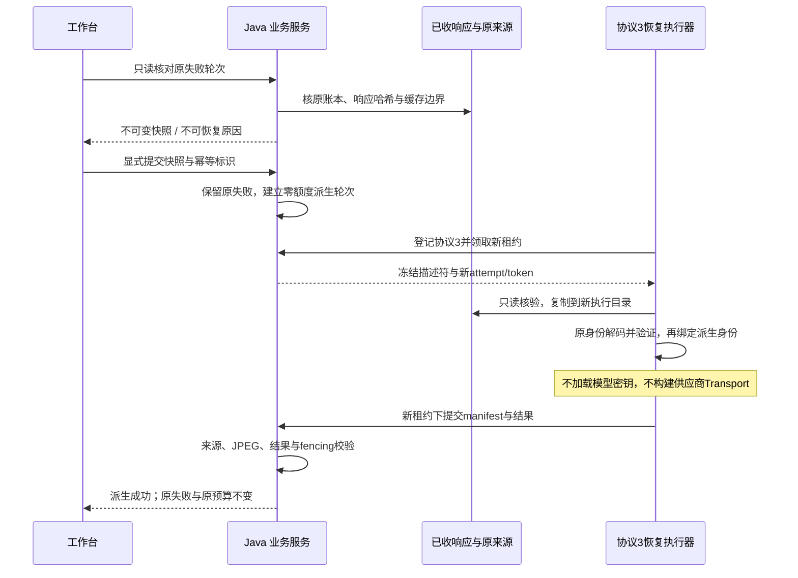

# 已收回答的零调用恢复

## 解决什么问题

模型已经返回 HTTP 200，但结果未通过本地输出校验，用户仍可能看到整轮失败。重新提问会重新占用请求预算，也不能保证再次得到同一份答案。

本功能增加显式的缓存恢复：核对原轮次的已收响应与来源，再用当前兼容解码规则恢复**已有首答**。恢复产生新的派生轮次，原失败、原响应、原预算和账本保留。它不是重新生成、模型重试或自动增加额度。

这也是本项目 Java 与 Agent 执行保障的一个具体案例：把“供应商已收到响应”和“业务已发布答案”分开建模，再通过可审计、可幂等的恢复动作连接两者。验收只能说明这条恢复链路有效，不能据此声称回答准确率、客户付费意愿或成本降低幅度。

## 首版范围

- 来源为同一视频内启用 `speech_lookup_v1` 的结构化画面轮次，结果版本为 1.4。
- 原轮次必须明确失败，原阶段错误为 `INVALID_AGENT_OUTPUT`，只支持第 1 次执行。
- 原模型账本必须全部为有完整响应引用的 `SUCCEEDED`；原文件必须仍在共享存储中且通过哈希与路径边界核验。
- 仅复用首个决策窗口、首个结构化回答。它必须已包含当前解码器能够接受的答案，不支持还需调用工具、继续请求或重新生成的情况。
- 新恢复轮次新增模型请求上限为 **0**，不提交 ASR、不做 embedding，不使用备用供应商。
- 缺文件、配置不符、哈希不符、未知/未决调用以及不支持的链路都明确拒绝；不能把“有一段缓存文字”当作可以发布的答案。

已经支持的 1.4 兼容规则仍只允许在解码副本中，为精确省略的非执行字段 `suggested_clip_instruction` 补 `null`。不会补正文、证据、引用、来源或缺失的观察，也不会改写原始响应。

## 使用流程

1. 在失败的画面问答中，明确点击核对可复用回答。核对只读，不发模型请求。
2. 核对通过后，显示可复用范围、零新增请求说明及原失败保留提示。用户再明确提交恢复动作。
3. 恢复动作冻结核对快照与独立幂等标识，创建新的派生轮次。它不读取当前输入框、模式、位置或预算草稿。
4. 支持恢复协议的 Worker 领取派生任务，用独立执行目录处理原响应副本，再由 Java 验收结果和实际图片。
5. 派生轮次成功后可正常回看引用、保存笔记和选择原句；原失败轮次仍可查看。恢复失败时保留两个记录，不自动转成重新请求。

提交回执未知时，先按原动作标识只读核对；只有精确的业务不存在才允许用户用同一标识、同一请求体重试。切换视频、隐藏或关闭页面不能取消已发出的写请求，也不能让迟到结果覆盖另一个视频的草稿。

### 公开接口

| 接口 | 作用 |
| --- | --- |
| `GET /api/agent-turns/{source}/response-replay` | 只读核对，返回原预算、可用状态、原因、快照及已建派生轮次 |
| `POST /api/agent-turns/{source}/response-replay` | `Idempotency-Key` + 仅含 `snapshot_hash` 的请求体，创建零调用派生轮次 |
| `GET /api/agent-turns/{source}/response-replay-submissions/{key}` | 按原动作标识核对提交；精确不存在为 `AGENT_RESPONSE_REPLAY_SUBMISSION_NOT_FOUND` |
| `GET /api/agent-capabilities/cached-answer-replay` | 独立声明 `cached_answer_replay_supported:true, worker_protocol:3` |

核对响应为 `{schema_version:1, source_turn_id, eligible, block_reason, snapshot_hash, source_budget:{max_text_calls,text_calls_reserved}, existing_turn}`。不存在的可恢复快照、原因或派生轮次显式为 `null`。创建与精确动作核对返回派生 Turn。

仅派生 Turn 增加 `replay_source_turn_id`、`replay_snapshot_hash`，其 stage 增加 `required_worker_protocol:3`；预算固定为 `0/0`。旧普通 Turn 的 wire 不变。一个原轮次最多建立一个恢复轮次，另一动作标识不能认领既有恢复为自己的回执；可通过原轮次的只读核对查看它。恢复沿用原会话的单活动轮次与总轮次上限。

两窗口用不同 key 竞争时，失败一方不自动清本机回执。用户可明确“查看已有恢复并解除本机未创建标识”：没有进行中的 POST，并重新按原 key 得到精确业务不存在、随后重新核对得到同源且唯一的既有派生轮次，才比较并删除该本机条目。此操作不认领另一个 key 的回执，不改变或取消任何服务端轮次；读取失败、普通 404 或本机条目被其他窗口替换时都保留。

本页首次提交若明确收到服务端已回滚的业务拒绝，可保留仅当前页面有效的拒绝证明；POST 结束且重新按原 key 确认精确不存在后，允许用户明确解除该未创建标识。仅白名单内的输入错误、缓存不可用/来源变化、会话忙/满或已有恢复拒绝适用。网络未知、旧本机条目、普通 HTTP 错误不适用；重试、隐藏、切源或刷新即撤销此证明，不能用上次拒绝清理后来结果未知的重试。

## 执行与信任边界



### 供应商响应与缓存

Java 的原 `model_call` 账本是响应来源的依据。描述符必须绑定原请求输入哈希、模型、响应路径和响应哈希；Python 还须核对响应包装中的 body 与首答缓存。仅把可修改的本地 state 和窗口文件重新算一遍哈希，不足以证明它来自已记账响应。

双端还须在原身份下重建首个完整模型请求，包含原提示词、原句观察、图片实际字节、历史及原预算计划，按原 BudgetTransport 的端点与请求体规范计算输入 hash，与原付费账本严格相等。这样即使图片、图片元数据和本地计划同时被修改，也不能把旧答案挂到一张没有实际入模的新图上。密钥与授权 header 不参与该身份，也不进入描述符。

原问题、历史、视频、ASR、分析、焦点、预查、实际 JPEG、原请求计划和输入身份均不可换。先在原身份下验证输入与结果，之后才把结果封装为新派生轮次；不能把新 turn ID 塞进旧计划绕过缓存校验。

原 attempt 目录只读，恢复只在新 attempt 的私有副本中处理。不得覆盖旧 `worker-result.json`、错误、原始响应、checkpoint 或账本。

### 协议隔离与零请求的硬约束

恢复沿用 `AGENT_EVIDENCE` 阶段，但要求 Worker 执行协议 **3**。支持画面预查的协议 2 并不表示支持恢复。ready 的 SQL 分页前过滤、首次 claim 和 claim 回执重放都需要校验注册会话的协议集合；旧执行器不能领取新任务。

Python 在检查供应商配置、构建普通 Transport 或进入常规 Agent 路径前分流恢复。恢复客户端拒绝所有 HTTP，预算固定为 0；缺失缓存必须失败，不能落入网络请求分支。Java 模型预留接口也独立拒绝恢复 owner，不能只依赖前端文案或 Worker 自觉。

新阶段仍使用正常 lease、attempt 和 run_token。取消、过期、旧回调和迟到完成服从原有 fencing；恢复结果不能直接把原 `FAILED` 改成 `SUCCEEDED`。

Java 验收还将派生结果的分项、scope 与非执行建议，同冻结的首个已收响应直接比对。合法却不同的回答也不能冒充恢复结果。原端点与物理重试策略若未完整持久化，需要用仍可用的非密钥配置重建原输入身份；不能通过猜测或更改原 hash 来恢复。

内部 claim 的 `agent_turn.cache_replay` 描述符为版本 1，冻结原 turn/session/stage、attempt/token、request/input/config hash、原模型额度和物理重试次数、非密钥端点、文件清单及已成功响应账本。`snapshot_hash` 是该描述符规范 JSON 的 SHA-256，不放进描述符自引用。文件 kind 限 `state`、`request_plans`、`speech_observation`、`focus_observation`、`window`、`provider_response`、`frame_cache`、`frame`、`trace`、`retry_policy`。

新 manifest 附带 `agent_cached_answer_replay` 回执，精确字段见 [共同契约](../contracts/agent-cached-answer-replay.schema.json)。它指明原请求、原响应、原窗口、解码规则和仅重绑定 `turn_id`，新增请求数固定为 0。回执不冒充新的模型轨迹，也不能单独替代原文件、账本和业务来源核验。

可用专用执行器处理恢复：

```powershell
& './scripts/worker.ps1' -EnvFile '你的本地Worker配置路径' -WorkerId worker-cached-replay -StageType AGENT_EVIDENCE -CachedAnswerReplayOnly
```

该模式仅登记协议 `[3]`，不能领取普通模型任务，也不要求视觉 API key。配置仍需包含 Java Worker 身份和正确的共享存储路径；原缓存配置校验需要的非密钥参数仍须匹配。普通 Worker 的旧协议与能力探测保持兼容。

## 验收要求

工程回归需要覆盖：

- 旧协议、旧指纹、旧未决提交与旧 budget 行为不变；协议 1/2 不可领协议 3。
- 核对只读、快照不可换、幂等重放、同源绑定、取消和旧 token 拒绝。
- 原账本有未决/未知调用、响应缺失/改动、路径越界或链接、原配置/原句/图片变化均拒绝。
- 图片、图片缓存与本地计划同时改成自洽数据，仍因原付费输入 hash 不匹配而拒绝；Java 冻结提示词资源与 Python 实际提示词有跨端字节契约检查。
- 首答是 tool、当前仍非法或需下一窗口时拒绝，不触发备用模型或格式修复。
- 恢复 owner 的模型 reserve 被服务端拒绝；Python 不构建普通模型客户端，新增供应商/ASR/embedding 请求数均为 0。
- 原失败与原额度保留；派生结果、真实 JPEG、笔记及来源引用通过正常服务端验收。
- 未知回执先只读核对；普通 HTTP 404、500、损坏响应不得触发新 POST。

实际验收需另行记录：输入来源、原失败、派生 ID、账本前后差异、原目录哈希、最终可读产物。使用真实已收响应的离线恢复，不是新一轮真实供应商推理，不消耗此前授权的未使用次数。

## 当前限制

该功能不能挽回未收到响应的请求，不能修复缺失证据、事实错误或缓存损坏，也不保证任意旧提示词在未来解码器下都能恢复。首答恢复成功说明现有证据与结构通过当前规则；语义是否充分仍需用户核对。

## 工程与实际缓存验收（2026-11-12）

- Java 定向 179 项、完整 `verify/package` 561 项通过，无失败、错误或跳过。覆盖真实 SQL 账本转换、协议 3 隔离、幂等创建、首答强绑定、来源损坏、取消及迟到提交；普通问答继续拒绝恢复凭证。
- Python 补强后定向 250 项、全量 2052 项及 102 个 subtest 通过，保留唯一既有 Windows/POSIX 行为 skip；Ruff 通过。联合修改 JPEG、元数据及计划仍因原付费输入 hash 不符而拒绝；Java 提示词资源与 Python 实际提示词有字节级契约检查。旧 profile 请求内容、提示词与缓存身份回归保持。
- 前端定向 34 项、全量 649 项与构建通过，仅有原有大 chunk 提示。原 SESSION/TURN 未决提交模块保持不变；恢复使用独立本机 namespace，覆盖未知回执、隐藏、切源、双窗口和明确拒绝后的受控解除。PowerShell 启动检查通过 24 次模拟启动，不启动真实 Worker 或模型。
- 在新的数据库与存储副本中，用生产 Java 和专用协议 3 Worker，实际恢复上一轮已经收到的真实首答。原轮次继续为 `FAILED / INVALID_AGENT_OUTPUT`，原预算维持 **已用 2 / 上限 4**；派生轮次为 `SUCCEEDED`，额度 **0 / 0**。没有新供应商、ASR 或 embedding 请求，没有使用上一轮剩余次数。
- 实际验证了协议 1/2 的 ready 与 claim 拒绝；在合法新租约下尝试模型预留也被 Java 明确拒绝。恢复保留原首答的五项内容及原句第 24、25 句引用，只为缺省建议补 `null` 并重绑定新 turn ID，没有继续执行模型工具。
- 派生结果的笔记、ZIP 与 JPEG 均经正常服务端验收；ZIP 的截图与原实际入模 JPEG 哈希相同，文字及 `source.json` 保留恢复来源和新增请求为 0 的标记。
- 保护来源库 32 表 1018 行保持不变；恢复库内所有原行、原列也保持一致。288 项原文件及副本各 496,770,247 字节逐项核 SHA-256 一致，最终 39 项实现文件冻结无漂移。原付费请求和失败状态没有被覆盖。

上述实际恢复复用已收到的供应商响应，证明的是零调用恢复与交付链路，不是一次新的模型推理，也不是独立回答质量评测。
