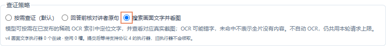
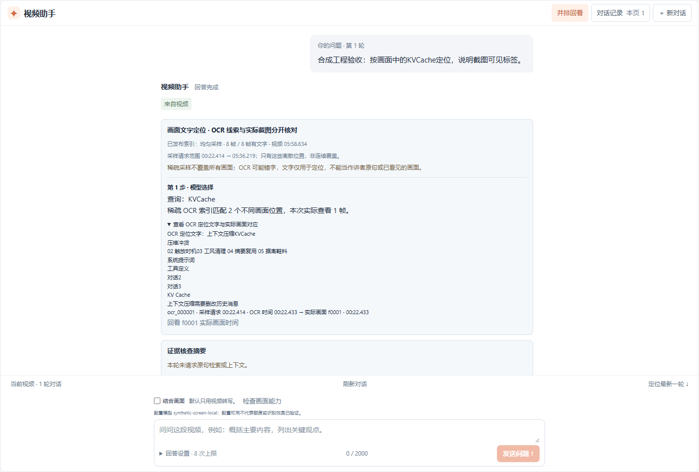
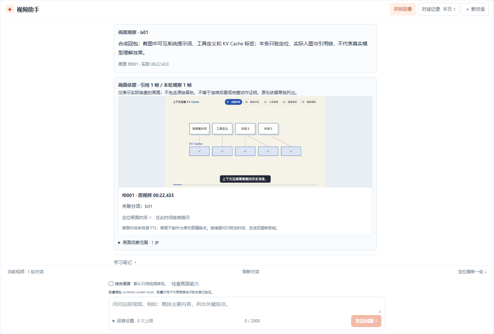

# Agent 按画面文字定位

状态：已实现并通过受控工程验收，真实供应商效果尚待评测。目标是让 Agent 找到“画面上出现、讲者未必念出”的术语，再实际查看对应截图。新增默认关闭的策略；不是全片逐帧理解，不自动重跑 OCR、转写或话题分析。

## 使用方式

当前任务需要完整、已发布的 OCR 分析。创建分析时选择「本地 OCR · 识别画面文字」，完成后进入视频对话，开启「结合画面」「分项证据回答」，在查证策略选择「搜索画面文字并看图」。没有来源时先提示，不自动补跑原分析。



问题可以直接包含要找的课件标题、图表标签或代码标识。模型决定查询词，程序记录实际命中范围和提供的图片；展开「查看 OCR 定位文字与实际画面对应」，再核对下方真实图片。图片卡可定位原视频、继续提问，或随本轮学习笔记保存。





## 模式和预算

新 `evidence_policy:"screen_search_v1"` 仅用于 `visual_mode:"frames"`、`evidence_mode:"structured"`，与 `speech_lookup_v1` 二选一。沿用 `AGENT_EVIDENCE` 阶段，要求执行协议 4；结果版本 1.5，prompt 为 `video-agent-evidence-screen-v1`。旧 1.0～1.4 的 SYSTEM、指纹、缓存和未知提交身份不改。协议 3 的已收回答恢复仍只支持原范围。

模型可选择 `search_screen_text(query,top_k)`，一次完成本地 OCR 文字检索与对应真实截图输入。`query` 最多 120 UTF-16 单元、非空；`top_k` 为 1～3。此复合工具计一次 MODEL 工具步，仍受原四步、同轮请求账本、32 帧、单图 1 MiB 和总图 16 MiB 限额约束。不新增 embedding 或隐藏模型请求，也不附加原句预查；模型仍可自行搜索原句或使用原画面工具。

以四次物理请求、每个逻辑请求最多三次尝试的上限为例，首个决策仍可选择一次复合工具，随后留出最终回答机会；本功能不改变原页面默认预算。重试和格式修复都计入原上限；需要继续检索讲者原句或抽查操作过程时可明确增加本轮预算，不保证一次工具足以回答完整问题。可选 USER_FOCUS 继续独立记录，程序不伪称模型选择了用户附加的位置。

## 已发布来源

只读取当前任务、当前 generation 的成功 ANALYSIS SEGMENT 及其 manifest。来源需与当前已冻结 TIMELINE 分析绑定：两个分析文件分别核对自己的 SHA-256 后比较 JSON 内容，不能要求其文件 hash 相同；Windows 换行可能不同。

独立校验四项 OCR 元数据、完整采样计划、连续帧 ID、源视频 SHA、每张旧 JPEG 的 SHA 与 PTS。沿用 OCR 图最大 4 MiB、元数据每项 1 MiB 和最多 120 帧边界，不套用新 Agent 图片的 1 MiB 限额。仅成功发布过的完整 OCR 来源可用，不扫描全局缓存或 FAILED attempt；全局缓存淘汰不应影响已发布证据。旧配置缺字段时按原 prefix / 16 解释，不套用当前默认值。

新增只读 `GET /api/jobs/{jobId}/agent-screen-source`，返回精确 `{screen_source:公开来源}`。无已发布 OCR 时返回 `AGENT_SCREEN_SOURCE_UNAVAILABLE`，损坏或不匹配时返回 `AGENT_SCREEN_SOURCE_INVALID`；两者都不创建轮次。独立能力接口 `/api/agent-capabilities/screen-search` 返回精确 `{screen_search_supported:true,worker_protocol:4}`，能力支持与当前任务有无来源分别核对。

UI 在创建本机提交记录前 fresh GET 核对来源，服务端 POST 再独立核对。竞态或未知回执继续保留原 key/body，不因当前缺 OCR 自动清除旧记录。

来源 GET 超时、断网或暂时不可用发生在业务提交之前：页面明确提示本次未提交，保留问题与设置，允许用户恢复连接后再次发送以重新检查；不创建回执或引导核对不存在的原提交。仅在对话或提问已经发送、回执未知时才进入原提交核对流程。404 仍提示升级，无可用 OCR 或来源损坏继续保留各自说明，不把来源问题泛称为网络超时。

新 turn 的 `screen_source_json` 冻结小型私有描述，不复制 OCR 正文到每个轮次。旧 Session.source 保持原三字段。私有 claim 字段名为 `agent_turn.screen_context`，精确结构如下：

```text
schema_version: 1
segment: {job_id, video_id, analysis_generation, stage_id, stage_type:"SEGMENT",
          attempt, run_token, input_sha256, manifest_key, manifest_hash}
analysis: {key, sha256}                    # 原冻结 TIMELINE 分析
ocr_config: {sampling_policy, max_frames, interval_ms}
screen_source: 公开来源
```

描述参与新阶段 input hash；claim 必须与已附的同源 SEGMENT 引用一致。读取路径限当前 attempt，拒符号链接、缺失、改字节或来源变化，不重建其他请求。公开 turn 和 1.5 结果的 `screen_source` 精确字段为：

```text
segment_stage_id, segment_manifest_hash, frames_hash, observations_hash,
index_version:"screen-text-literal-v1", index_hash, duration_ms,
sampling_policy, interval_ms, frame_count, text_frame_count, coverage_truncated
```

不公开存储路径、run token 或 OCR 全文。`frame_count` 为 1～120，`text_frame_count` 可为 0；空文字是合法来源。稀疏采样及 `coverage_truncated:false` 均不表示连续覆盖。

新来源中的 `segment_stage_id` 为小写规范 UUID，不改变旧结果的通用 ID 规则。公开采样字段须正安全整数，frame_count 不超过时长与间隔可推导的采样数；prefix 的裁剪标记与实际数量一致，uniform 为 false。实际生产来源仍按已持久化配置与原 45 秒间隔独立核对。

## 确定性文字检索

无全局索引缓存，最多 120 条记录在内存处理。按既有 JS trim 空白集合分词，分出的非空词在去重前最多 8 个，再折叠 ASCII A～Z 并去重，全部字面命中；9 个重复词也拒绝。不做 Unicode casefold、NFKC、语义检索或拼写纠错。query 保留实际原文，不重写首尾空白；可用全部 JS 空白（含 VT / FF）分隔，其他 C0/C1 和孤立代理拒绝。原 OCR 文字保持原样，至多 2000 个 Unicode 码点 / 4000 UTF-16 单元，要求 Unicode 完整，不套用新问题的控制字符限制。匹配结果按原 requested 时间排序；相同有理数 PTS 只选一处，去重后计 total_match_count，再取 top_k，不把顺序称作语义相关性排名。

索引行精确字段为 `ocr_frame_id,requested_ms,ocr_timestamp_ms,source_pts,source_time_base,observed_text,ocr_sha256`。用于摘要的 HashRow 将 `observed_text` 替换为原文字 UTF-8 字节的 `observed_text_sha256`，实际索引与检索回执仍保留原文。摘要输入因此只含 ASCII 字段、整数和 hash，避免 Java/Python 对控制字符 JSON 转义的十六进制大小写差异，也不误改文字中的字面量 `\\u001B`。`index_hash` 为以下对象递归按键排序、无空格的 UTF-8 JSON 的 SHA-256：

```text
{index_version,source_hash,duration_ms,segment_manifest_hash,
 frames_hash,observations_hash,rows:[按原帧顺序的 HashRow]}
```

用原 `requested_timestamp_ms` 调用当前 FrameStore，重新取得标准 Agent JPEG；旧 OCR 小图只负责定位，不冒充实际入模图片。新帧与定位帧的 `source_pts * source_time_base` 必须有理数精确相等；旧 OCR 的毫秒显示允许原验证器的舍入误差，不强行改成新帧的毫秒值。图片分辨率与 JPEG hash 可以不同。

## 回执与引用

新结果包含 `screen_searches`，恰好对应每个实际 `search_screen_text` 工具步。每条精确字段：

```text
tool_step, status, error_code, total_match_count, hits
hits[]: {ocr_frame_id,requested_ms,ocr_timestamp_ms,source_pts,
         source_time_base,observed_text,frame_id}
```

- `OBSERVED`：有命中且实际图片已提供，hits 为实际选中项；error_code 为 null。
- `EMPTY`：已发布索引的文字数量为 0，计数和 hits 为空；不是全片没有文字。
- `NO_MATCH`：索引有文字，但此次有界字面 AND 查询无命中；计数和 hits 为空。
- `TOOL_ERROR`：受上下文、重复调用或取图限制，hits 为空；error_code 为 `CONTEXT_LIMIT`、`FRAME_UNAVAILABLE`、`FRAME_POSITION_MISMATCH` 或 `DUPLICATE_TOOL_CALL`。完整性与取消错误直接中止，不冒充工具无命中。

所有状态（含错误）都保留本地确定性查询按实际 PTS 去重的完整计数，不用 0 代表未知。重复调用和上下文限制也可纯内存重算计数，但不重复取图；FRAME_* 错误必有至少一个候选。

成功 hit 的 `frame_id` 必须是本轮真实 FrameStore 记录，与工具的 `result_frame_ids` 按 requested 时间逐项对应，不强制 fID 升序。USER_FOCUS 先产生的 f0001 可以在后续检索中复用；重复看同一帧不算新增帧。OCR 文字不能用作 SPEECH 原句引用；只有实际入图的帧能支持 FRAME，新复合工具不能冒充 `inspect_clip` 支持 SAMPLED_CHANGE。

新 1.5 先独立核对来源、全部检索回执、原四步轨迹、原工具重复规则与图片映射。仅在内部临时副本中，将带新图片的复合步骤映射成完整等价 inspect_frames 批次；删除无帧 visual 步、完全复用已观察帧的复合步骤及 inspect_frames，保留非空 inspect_clip（即使全是复用帧），再重编号并复用 1.3 的模态、引用并集与分项校验。这样先取图失败后检索成功、检索后显式重看、focus 同帧复用均不会被投影误判；真实返回体、步骤及 origin 不改。`retrieval_mode` 继续只表示 ASR 检索，新文字算法由独立 index_version 描述。

仅新 1.5 对所有同名、相同参数的重复工具调用都要求原句 ID 和图片 ID 为空，包含 ASR 搜索、上下文与话题工具；对象键顺序不改变参数身份。新 screen 重复另有明确错误回执，已有证据仍可引用。不改旧版本的已存轨迹规则。

笔记、原句锚定剪辑、引用画面继续提问与严格历史读取均需识别 1.5，仍保留“已验证来源”和“模型语义正确”的区别。公开校验可核对回执内部关系，不能假称拥有全 OCR 索引或重算完整排名；Java 发布与文件读取边界另核完整已冻结来源。

新 1.5 的模型适配层沿用已验证的保守默认规则：若回答决策精确只有 `type,answer_scope,answer_blocks`，仅在独立解码副本中补非执行建议 `suggested_clip_instruction:null`。显式非法值、其他缺项或额外字段仍拒绝，不补正文或证据；最终 wire 继续严格完整。原 SYSTEM、请求计划、已收原始响应与配置 hash 不改，旧 1.3 及以前不获得此兼容，也不扩展协议 3 恢复。

## 工程验收（2026-11-12）

- Java 定向 113 项、完整 verify/package 601 项全部通过，无失败、错误或跳过。覆盖实际 MySQL 的来源冻结、无 OCR 拒绝、协议 4 容量查询/领取/结果接收、笔记与原句锚定；普通 JAR 已核静态 UI 资源为 0，打包新类与受测类逐字一致。
- Python 最终定向 403 项、全量 2211 项与 102 个 subtest 通过；1 项既有 Windows 终止行为 skip。Ruff 通过。真实 FrameStore、BudgetTransport 与 ResilientTextTransport 测试覆盖取图原子性、帧/字节/上下文限额、500 重试、UNKNOWN、来源漂移及 0 新请求缓存重放；旧 1.0～1.4 / 协议 3 回归保持。旧全量 2198 项及其冻结另行保留；最后增加 13 项 nullable 建议字段兼容回归，证明两次成功请求即可完成、原始响应不被改写，0 预算缓存重放不新增 HTTP 或账本。
- 前端前一修订全量 711 项通过；最后仅将新 source UUID 收敛为规范小写，最终定向 165 项、类型检查和生产构建通过。两次修订与日志分别保留。最终生产 dist 的真实 API 浏览器验收另完成 7 项具名检查，覆盖定位记录、实际 JPEG、笔记、引用时间继续提问、策略/草稿保留及 320×568 可达性；没有写请求或页面错误。
- 三端共同使用 30 个完整回答与 20 个查询向量，另有真实发布文件测试。样例 hash、文字和帧元数据明确为合成协议数据；不用它们冒充真实图片或识别效果。

实际隔离运行复用同一 358,634 ms 技术课程及原 43 句已验证转写。先用本地 OCR 生成 8 帧准备缓存，再在新任务的生产 MEDIA → ASR 复用 → SEGMENT → TIMELINE 流程中命中缓存、发布 14 项真实产物；新来源接口成功。已有 90 分钟任务的完整 120 帧来源也通过新接口校验，没有重新识别。

新建 1.5 问答明确使用合成模型回包，首个物理响应为 500，独立重试后返回 `search_screen_text("KVCache",1)`，程序从两处不同采样位置中实际查看第一处，再生成 FRAME 回答。请求定位 22,414 ms，截图实际为 22,433 ms、PTS `344576 * 1/15360`，真实 JPEG 为 960×544 / 37,109 字节；入模字节、发布引用与浏览器读取 SHA-256 相同。它是新的标准截图，非原 OCR 小图。

新分析有 1 条合成 TEXT 调用，新 Agent 有 3 条物理调用、预算 3/4；合计新增 4 条合成账本，实际供应商、ASR 和 embedding 请求均为 0。500 的原账本保留 `UNKNOWN_OUTCOME` 及收到的响应摘要，其余 3 条为 SUCCEEDED，没有清记录或重置预算。原库 32 表、1,051 行和 279 条调用记录不变，隔离副本中继承的旧行与原文件均保留。

笔记实际 GET 与含图 ZIP 响应通过；本轮检查 ZIP 响应头和包签名，不声称完整审计其所有内容。浏览器采用冻结生产 dist 的有限静态路由与真实 Java GET/HEAD，没有启动网页监听服务；未验证连续原视频播放。文档截图另通过真实「专注对话」操作原样捕获，无样式修改或图像后期处理。

ASR 原文不包含连续的字面串 `KVCache`，不代表讲者没有念过该术语，也不能把本样本当作语义召回提升。受控模型只证明工具、预算、实际图片和引用的执行闭环；真实视觉模型是否选择正确查询、理解课件以及改善回答，需要另有上限的供应商试验和分场景对照评测。当前没有识别准确率、召回率或付费需求提升结论。

本地冻结、失败前轮日志、源文件审计与受控运行证据保留在忽略目录 `data/runs/agent-screen-search/`；前端日志另在 `data/runs/screen-search/`。真实视频、OCR 正文、数据库、供应商凭证和模型原始响应不提交。
