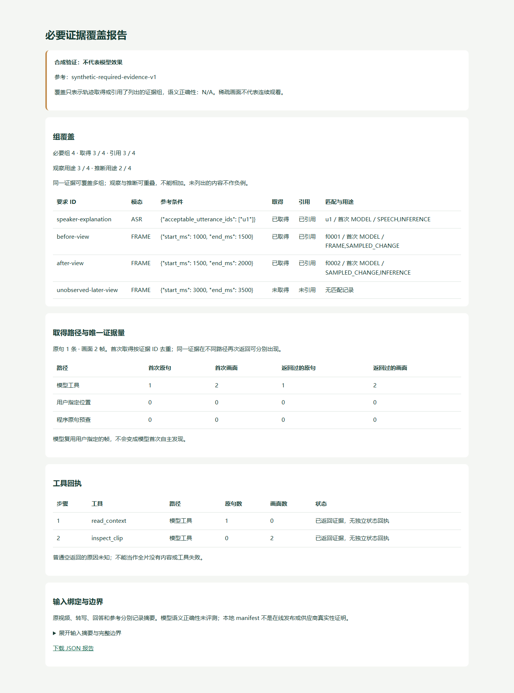

# Agent 必要证据覆盖评测

状态：已实现并通过工程验收。离线检查一个问题所需的原句、画面是否出现在回答的取证轨迹和引用中，用于准备文本与视觉方案的可复现对照。它不请求模型，不生成 ASR 或 embedding，不修改业务任务或原回答。

## 评测什么

先为一个问题列出必要证据，再读取相同问题、相同视频与转写来源的回答：

| 层次 | 含义 | 当前工具的边界 |
| --- | --- | --- |
| 取得 | 轨迹记录工具返回了所需原句或画面 | 验证结果结构与本地文件一致性；不独立证明外部供应商收到过这些数据 |
| 引用 | 回答实际引用了该证据 | 分开观察用途、推断用途与旧版未分项引用 |
| 语义正确 | 证据是否支持回答、解释是否准确 | 不自动评分，报告保留 N/A |

一个 ASR 要求可列多条可接受原句，命中任意一条算覆盖这一组；不是把每条候选都当分母。一个 FRAME 要求是一段半开时间窗 `[start_ms,end_ms)`，使用帧的实际有理数 PTS 匹配，不使用抽帧请求时间或四舍五入后的显示时间。参考最多列 200 组，只评价明确列出的部分；未列出的内容不算负例，因此不提供精确率或未引用内容的“错误率”。

同一证据被多次返回只取得一次，但可以覆盖多个参考组；组覆盖数不等于唯一证据量，唯一数量见报告 `acquisition`。首次由 `USER_FOCUS` 提供的图片仍标用户指定，之后模型复用它不会被记为 Agent 自主新发现；程序原句预查 `EVIDENCE_POLICY` 与 `MODEL` 也分别记录。直接观察引用与推断引用可能重叠，不能相加当作新的证据量。旧 1.0～1.2 没有分项用途，标记 `legacy_untyped`，不补造 SPEECH / FRAME 分类。

普通工具返回空集合只说明这一步没有提供证据，不能推断“全片没有内容”或“工具失败”。仅有明确的 1.4 原句预查、1.5 画面检索回执时，才细分已有状态；其他原因保留未知。

## 先运行合成示例

仓库提供四个小型 JSON：相同问题的文字回答、分项画面回答、转写、参考要求。图片元数据和回答均为构造数据，只有 `--fixture` 可使用；没有真实 JPEG 或视频，也不代表模型效果。

在仓库根目录运行，报告目录必须尚不存在：

```powershell
uv run --frozen --no-sync livecut evaluate-agent-evidence `
  './fixtures/agent-evidence-evaluation/text-answer.json' `
  './fixtures/agent-evidence-evaluation/reference.json' `
  --transcript './fixtures/agent-evidence-evaluation/transcript.json' `
  --fixture --output-dir './data/evaluations/agent-text-example'

uv run --frozen --no-sync livecut evaluate-agent-evidence `
  './fixtures/agent-evidence-evaluation/visual-answer.json' `
  './fixtures/agent-evidence-evaluation/reference.json' `
  --transcript './fixtures/agent-evidence-evaluation/transcript.json' `
  --fixture --output-dir './data/evaluations/agent-visual-example'
```

打开输出目录的 `index.html`，查看各组匹配、引用用途和取得路径；`report.json` 保留输入摘要与计数。示例特意包含一组未取得的后段画面，用于验证缺口会保留。两个示例的差异是测试输入设计，不能写作模型提升。



## 用自己的视频准备参考

```powershell
uv run --frozen --no-sync livecut init-agent-evidence-reference `
  'C:/videos/course.mp4' './storage/path/to/transcript.json' `
  --video-id '替换为该视频ID' --question '替换为实际提交的完整问题' `
  --output './data/evaluations/course-reference.json'
```

命令只生成来源绑定、`not_annotated` 状态和空要求。它不会从待测回答自动生成“标准答案”。先独立查看原视频与转写，再编辑参考：

```json
{
  "annotation_status": "annotated",
  "provenance": {
    "label_source": "agent_assisted",
    "split": "dev",
    "independently_reviewed": false
  },
  "requirements": [
    {"id": "reason", "modality": "ASR", "acceptable_utterance_ids": ["实际原句ID"]},
    {"id": "diagram", "modality": "FRAME", "start_ms": 22000, "end_ms": 26000}
  ]
}
```

上面只展示应编辑的字段，其余来源、问题和参考 ID 保留模板内容。时间与 ID 是格式示意，需替换为实际独立检查的证据。未标注时计数不产生覆盖率，不能用空要求获得满分。

`agent_assisted` 参考限定 `dev` 且未独立审阅；人工开发参考也需如实声明。只有显式 `human / test / independently_reviewed:true` 才标作“声明已独立审阅的人工作为参考”，这个声明本身不是真实性证明。建立测试集时应按原始视频划分，避免同一视频的问题同时用于调优和最终评测。

## 核对实际文件

真实文件模式提供原视频、原转写、回答及其执行 manifest、共享存储根目录：

```powershell
uv run --frozen --no-sync livecut evaluate-agent-evidence `
  './storage/path/to/agent-answer.json' './data/evaluations/course-reference.json' `
  --transcript './storage/path/to/transcript.json' `
  --source 'C:/videos/course.mp4' `
  --answer-manifest './storage/path/to/manifest.json' `
  --storage-root './storage' `
  --output-dir './data/evaluations/course-run-001'
```

支持已有 1.0～1.5 回答，沿用各自的严格校验，不改提示词、缓存或未决提交。视频 SHA、转写原文件 SHA、实际时长、视频 ID 和完整问题必须一致；转写句子与时间、manifest 的来源与文件清单、实际 JPEG 的摘要和尺寸分别核对。输入变化、损坏图片或路径越界时拒绝生成成功报告。合成模式与真实文件参数互斥。

manifest 的来源、租约及 generation 是本地文件声明，工具不查询 Java 的在线发布状态，也不验证供应商账单或网络传输；有真实视频不等于模型答复真实。1.5 的公开索引摘要可以保留来源身份，没有完整冻结 OCR 索引时不声称重算检索排名。报告不复制视频、截图、ASR 正文、回答正文或私有绝对路径。

1.4 零调用恢复结果可附带 `cached-answer-replay.json`。评测器核对该同 attempt 文件的摘要、严格恢复字段及新轮次身份，报告仅标记恢复声明一致；不会据此重新读取供应商响应、复活原任务或认证历史计费。真实文件模式的输出目录须位于共享存储根目录之外，避免向冻结 attempt 或缓存添加文件。输出使用新目录和独占文件发布，`index.html` 最后出现；已有目录及失败残留不会覆盖，重试请另选报告目录。

临时 JSON / HTML 写入并同步后，最终报告发布前统一复核视频、三个 JSON 输入、manifest 和全部引用文件（含 JPEG、trace、恢复声明）的摘要。中途变化或无法重新核对时返回 `AGENT_EVIDENCE_INPUT_CHANGED`，清理本轮临时文件，不生成成功页面。此关口核对经检查的文件版本，不持有阻止外部写入的全程文件锁，也不宣称实现了文件系统快照。

同一参考可以分别评测文字、给定位置看图、自主取证等答案，再比较各组取得与引用差异；用户焦点、标签来源、问题版本和原始视频需保持可解释。样本很少或参考由开发者辅助标注时，只报告开发观察，不推导整体准确率、付费收益或生产可用性。

## 验证记录

2026-11-12：核心统计 61 项、文件与报告边界 53 项回归，覆盖六个既有答案版本、有理 PTS、组内 OR、引用角色、来源漂移、恢复声明、目录竞态及失败发布。新增的 8 项回归先复现 HTML 生成后输入变化仍被发布的问题，再验证统一关口拒绝发布。完整 Python 回归 2325 项通过，保留 1 项原有 Windows 平台跳过，另有 102 个子测试通过；Ruff 与 diff check 通过。

已运行文中的合成 CLI 示例、真实视频的未标注模板命令及 N/A 审计。生成报告经有限静态浏览器检查，覆盖桌面、320px 窄屏、JSON 原字节读取及正文可达性；未启动网页监听服务，README 截图取自实际合成报告，无图像后期处理。

另复用同一课程的已有 1.3、1.4 和 1.5 成功结果，分别核对原视频、原转写、manifest、实际 JPEG 与可选 trace / 恢复来源文件。1.3 记录一张用户指定画面、没有取得原句；1.4 的恢复结果记录三条程序预查原句与同一用户画面，不能记为模型自主检索；1.5 记录复合工具取到的实际截图，其模型回包为先前的合成工程样例。各文件在检查前后摘要不变。

这些参考在查看既有结果之后构造，明确为 `agent_assisted / dev`，只验证评测机制和来源链路，不构成独立效果对照。工具也没有认证历史供应商来源或计费。当前不提供回答准确率、语义质量或提升数字；本轮新增外部模型、ASR、embedding 请求均为 0。原日志、失败准备记录、冻结与文件验收保留在忽略目录 `data/runs/agent-evidence-evaluation/`。
