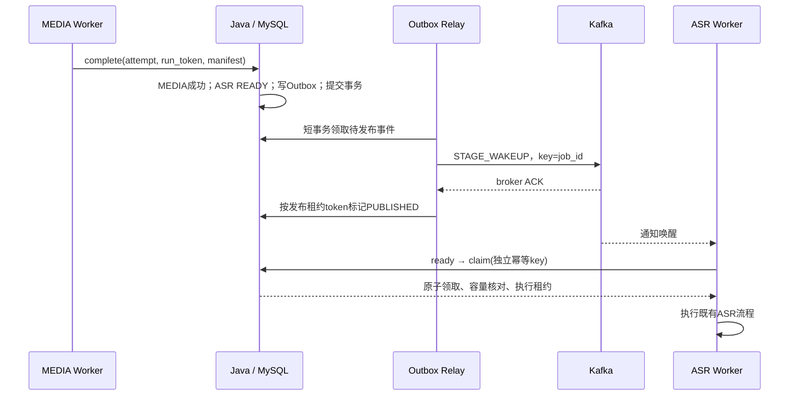

# Kafka 阶段通知与可靠调度

本次将 Worker 空闲时每 3 秒查询 READY 的主路径改为 Kafka 唤醒。Java 原本就会在完成事务内解锁后继阶段；现在同一事务还会写入 Outbox，通知到达后 Worker 查询并竞争领取可执行阶段。

## 执行链路



消息契约见 [stage-wakeup.schema.json](../contracts/stage-wakeup.schema.json)。只包含事件、任务、阶段、协议和原因，不包含模型输入、密钥、文件路径或 run token。通知不能代替 Java 的状态、来源、能力、容量和租约核验。

## 一致性与恢复

- **事务 Outbox**：新分析、准备复用、重试、正常交接、导出、剪辑、字幕和 Agent 的 READY 入口均在原业务事务内记录通知。回滚时状态和事件一起回滚。poll 模式不写新通知，升级后启动补查可以发现既有 READY。
- **至少一次投递**：relay 使用短事务、`FOR UPDATE SKIP LOCKED` 和 60 秒租约领取事件，网络发送在事务外。producer 配置 `acks=all`、idempotence 和有限客户端重试；broker 确认后才标记 PUBLISHED。失败保留同 event_id/payload，按 1～64 秒退避补发，不丢弃业务任务或清空预算。
- **重复安全**：发送成功但落库前崩溃可能重复通知。原 claim 幂等键、事务领取和 attempt/token fencing 仍决定谁执行、谁提交。Kafka offset 提交只表示通知已接收，不能当成任务成功，也不能宣称业务恰好一次执行。
- **异构执行器**：每个 worker_id 派生独立 consumer group 接收广播，避免通知被同组中无相应能力的实例消费。当前按工作台规模采用广播，未声称是大规模集群的最优拓扑。相同 worker_id 仍须遵守原单进程日志和实例身份约束。
- **释放容量**：完成、失败、取消产生 `CAPACITY_RELEASED`，也唤醒其他能力或其他任务的 Worker，避免消息到过但当时无容量而永久等待。
- **启动与断连**：先完成分区分配及起始 offset 初始化，再做一次 READY 补查；独立消费线程在长视频计算期间持续 poll。断连有界重连，耗尽后报错退出，不静默切回高频查询。计算仍受原 Worker 租约和断连保护。

还有三类定时工作需要区分：relay 定期读取**事件表**，Java 恢复到期租约和延迟重试，Worker 默认每 60 秒补偿漏通知。正常阶段交接由 Kafka 唤醒；前端刷新、SSE 和上传清理与本次计算调度是不同机制。relay 使用独立 scheduler，broker 故障不会占用原维护定时器。

Outbox 当前保留已发布记录供核查，尚未提供自动归档；长期部署应监控容量并制定保留周期。Compose 是单机 KRaft、单副本开发配置，不具备生产集群高可用保障。

## 启动

按 README 准备 `.env.compose` 和 `.env.java`，启动数据库、Kafka 和 topic：

```powershell
docker compose --env-file .env.compose -f infra/compose.yml --profile kafka up -d mysql kafka kafka-init
docker compose --env-file .env.compose -f infra/compose.yml --profile kafka ps -a
```

已有原生 MySQL 时，将第一条命令末尾改为 `up -d kafka kafka-init`，保留原数据库配置。

等 `kafka` healthy 且 `kafka-init` exited(0)。topic 为 3 分区、单副本，宿主机地址 `127.0.0.1:19092`。修改 topic 时同步两份配置的 `LIVECUT_KAFKA_TOPIC`。Java 和 Worker 使用相同的本地配置：

```dotenv
LIVECUT_DISPATCH_MODE=kafka
LIVECUT_KAFKA_BOOTSTRAP_SERVERS=127.0.0.1:19092
LIVECUT_KAFKA_TOPIC=livecut.stage-wakeup.v1
LIVECUT_KAFKA_RECONCILE_SECONDS=60
```

```powershell
# 终端1：执行V28迁移并启动Java
.\scripts\java.ps1 -Task Run
# 终端2：自动安装kafka extra，持续监听
.\scripts\worker.ps1
```

不加 `-Once`；手工单次验收请明确 `-DispatchMode poll -Once`。新配置示例启用 Kafka，未设置 mode 的旧部署仍默认 poll，便于先升级再切换。已有私有 `.env.java` 需显式加入配置，示例文件不会自动修改私有文件。

直接使用 CLI 时，先在当前进程配置原有 Worker 口令和模型凭证：

```powershell
uv sync --locked --extra ocr --extra kafka --dev
uv run --frozen --no-sync livecut worker --java-url http://127.0.0.1:8080 --storage-root ./storage --journal-dir ./data/worker-journals/kafka-local --worker-id kafka-local --dispatch-mode kafka --kafka-bootstrap-servers 127.0.0.1:19092
```

Kafka 只改变调度，不减少现有模型请求的费用或取消预算限制。生产 TLS/SASL、权限和多节点配置不在本机配置范围内。

## 核查与验收

```sql
SELECT status, COUNT(*) FROM stage_wakeup_outbox GROUP BY status;
SELECT event_id, stage_id, attempts, last_error_code
FROM stage_wakeup_outbox WHERE status <> 'PUBLISHED' ORDER BY available_at LIMIT 20;
```

Worker 输出 `dispatch-subscribed`、`dispatch-notified`、`dispatch-reconnecting`、`dispatch-message-rejected`、`dispatch-reconcile`。坏消息被拒绝并跳过，不输出正文或认证配置；低频补查仍能发现真正的 READY。

测试覆盖事务回滚、持久补发、过期 relay 回执、重复唤醒、坏消息、分区起始位置、重连、停止和旧 poll 模式。真实 broker/API 冒烟工具为 [kafka-dispatch-smoke.py](../scripts/tests/kafka-dispatch-smoke.py)，只用于**全新独立 API、数据库和共享存储**。会创建合成视频和测试任务，结束时取消剩余阶段，保留产物。

```powershell
# 独立测试API启动后提供其测试口令，禁止指向日常工作台
uv run --extra kafka python scripts/tests/kafka-dispatch-smoke.py --java-url http://127.0.0.1:18089 --storage-root C:/scratch/livecut-kafka/storage --output-dir C:/scratch/livecut-kafka/smoke-01 --bootstrap-servers 127.0.0.1:19092
```

它先让两个不同能力 Worker 空闲 4 秒，确认没有旧 3 秒 READY 查询，再由真实 Kafka 唤醒 MEDIA，实际提取音频，随后唤醒独立 ASR Worker。ASR 用明确的本地合成转写，不请求任何 ASR/文本/视觉服务。核对 600 秒补偿窗口内的具体阶段消息、真实领取与 attempt；不证明识别效果。

面试可围绕事务 Outbox、至少一次通知、异构执行器、容量释放、租约隔离和故障补偿讲清取舍。吞吐量、延迟提升与费用下降需另有基准测试，当前不填写此类成绩。

## 本轮实际验收

Java 完整 `verify/package` 为 615 项通过，0 失败/错误/跳过；Python 为 2375 项及 102 个 subtest 通过，保留 1 个既有 Windows 跳过项。PowerShell 7 和 Windows PowerShell 的启动模拟均通过，包括显式 poll 覆盖 Kafka 环境配置、补偿间隔继承和拒绝 Kafka 单次执行。

独立临时 MySQL、API-only JAR 和实际 Apache Kafka 4.2.2 KRaft broker 的联合验收通过：两个不同能力 Worker 的空闲 4 秒窗口中 READY 查询均为 0；MEDIA 和 ASR 经各自 READY 消息唤醒后成功，attempt 均为 1；原消息字节重放 3 次、实际触发补查后仍未重复执行。6 条 Outbox 记录全部 PUBLISHED，消息通过共享 Schema，模型账本为 0。MEDIA 实际处理合成 MP4，ASR 为本地合成转写，剩余阶段在验收后取消；这不是完整 AI 识别效果测试。

本机 Docker daemon 未运行，Compose 仅执行了配置校验；真实消息链路使用原生 Java broker 验证，不能把它写成 Docker Compose 已启动验收。
